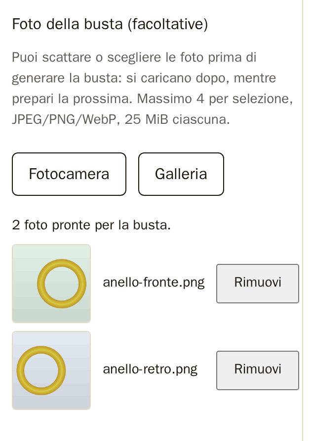
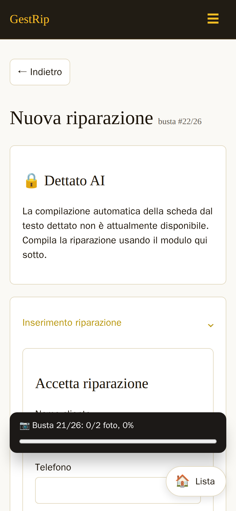
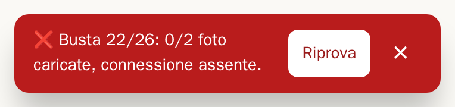
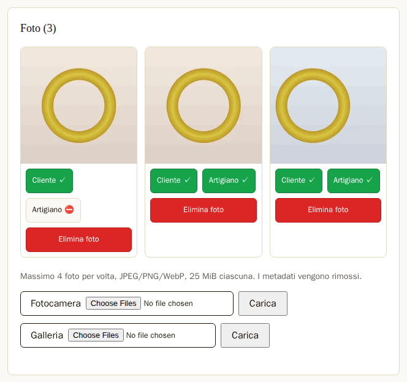
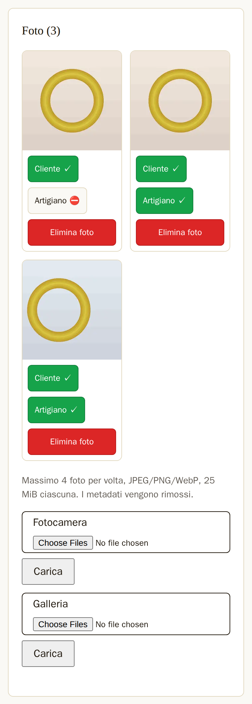
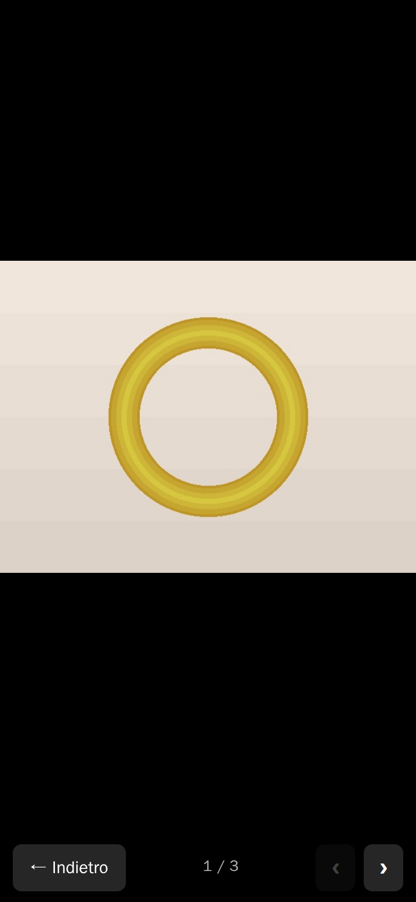

# Foto

Ogni busta può avere delle foto dell'oggetto: come è arrivato, i difetti, il lavoro finito. Le foto
si fanno o si scelgono in due momenti: in «Nuova riparazione», prima di generare la busta, e nella
scheda della busta, quando si vuole. Titolare e dipendente possono fare tutto quello che dice questo
capitolo.

## Le regole comuni

Le foto si fanno o si scelgono con due pulsanti. «Fotocamera» apre la fotocamera posteriore del
telefono per scattare una foto nuova. «Galleria» apre le foto già fatte e salvate nel telefono o nel
computer.

GestRip accetta foto in formato JPG (o JPEG), PNG e WebP. Se una foto è in un altro formato, il
programma la rifiuta con «Formato non supportato.».

Ogni foto può essere grande al massimo 25 MiB. Se una foto è più grande, il programma la rifiuta con
«Foto oltre il limite di 25 MiB.». Le foto del telefono di solito sono molto più piccole.

Il limite di 4 foto vale in modo diverso nei due posti. Nella scheda si scelgono al massimo 4 foto
per volta. In «Nuova riparazione» si tengono al massimo 4 foto per pulsante: 4 con «Fotocamera» e 4
con «Galleria». Se si va oltre, compare «Massimo 4 foto per volta.». Che cosa succede alle foto in
più lo dicono le sezioni sotto.

Nelle schermate di questo manuale i campi per scegliere i file dicono «Choose Files» e «No file
chosen»: è il browser usato per le schermate, che è in inglese. Sul telefono e sul computer del
negozio lo stesso campo è in italiano, per esempio «Scegli file».

Ogni foto viene ripulita prima di essere salvata. GestRip toglie la posizione GPS e gli altri dati
nascosti che la fotocamera scrive nel file, la gira nel verso giusto e la salva in JPEG. Il nome del
file scelto si conserva, ripulito dai caratteri strani.

Le foto «Ultra HDR» dei telefoni recenti si caricano come tutte le altre. Sono, per esempio, le foto
ritagliate o ingrandite nella Galleria di alcuni telefoni Android. GestRip salva la foto normale:
l'effetto HDR, cioè la luminosità in più sugli schermi che lo mostrano, si perde.

I PNG e i WebP animati non si caricano: GestRip li rifiuta come foto non valide. Nella scheda compare
«Foto rifiutata o non salvata.», nella barretta della coda «foto rifiutata».

La prima foto caricata su una busta che non ha ancora foto diventa la **foto della busta**.

## Foto in «Nuova riparazione»

In fondo al modulo di «Nuova riparazione» c'è la parte «Foto della busta (facoltative)», con i
pulsanti «Fotocamera» e «Galleria». Le foto si possono scegliere prima di premere «Genera busta».

*Figura 3.1 — «Nuova riparazione» sul telefono: due foto scelte dalla Galleria, ognuna con «Rimuovi».*

Ogni foto scelta compare sotto i pulsanti con un'anteprima, il nome del file e il pulsante
«Rimuovi». Sopra c'è il conto, per esempio «2 foto pronte per la busta.».

Con «Fotocamera» si possono tenere al massimo 4 foto, e altre 4 con «Galleria». Se una scelta
nuova porta oltre 4 le foto dello stesso pulsante, quella scelta non si aggiunge e compare «Massimo 4
foto per volta.». Le foto già scelte restano.

Se una foto della scelta non va bene, compare il nome del file con il motivo, per esempio
«anello.heic: Formato non supportato.». Un file vuoto dà «Foto vuota.». Le altre foto della stessa
scelta si aggiungono lo stesso.

Le foto scelte non salgono subito: restano nel telefono finché non si preme «Genera busta». Se il
modulo torna indietro con un avviso (per esempio quello del codice QR mancante), le foto scelte
restano al loro posto.

Le foto scelte valgono solo per il modulo aperto. Se prima di «Genera busta» si ricarica la pagina
«Nuova riparazione», oppure si esce e poi si torna a «Nuova riparazione», il modulo è nuovo: le foto
scelte prima si tolgono e il programma lo dice: «Le foto scelte prima sono state tolte: scegli di
nuovo quelle di questa busta.». Così una foto non finisce mai sulla busta di un altro cliente.

## Le foto salgono da sole dopo «Genera busta»

Dopo «Genera busta» le foto salgono da sole sulla busta appena creata, una alla volta. Mentre salgono
si può lavorare normalmente: compilare subito la busta dopo, aprire un'altra pagina, ricaricare la
pagina, chiudere e riaprire l'app. Il programma non chiede conferma prima di uscire da una pagina.

Una foto non sale mai due volte. Se la pagina cambia a metà invio, la pagina dopo riprende l'invio e
GestRip tiene una copia sola della foto.

Mentre le foto salgono, in basso nella pagina c'è la **barretta della coda**. Dice il numero della
busta, quante foto sono salite e la percentuale, per esempio «📷 Busta 21/26: 0/2 foto, 0%».

*Figura 3.2 — La barretta della coda sul telefono: le foto della busta 21/26 salgono mentre si compila la busta dopo.*

Sul telefono la barretta sta sotto il menu ☰: il menu si apre e si usa anche mentre le foto salgono.

Se ci sono più buste con delle foto da mandare, la barretta ha una riga per busta. Le buste vanno
nell'ordine in cui sono state generate.

Le foto salgono solo per la persona che le ha scelte. Se quella persona preme «Esci», le foto restano
nel telefono e ripartono quando la stessa persona rientra. Un'altra persona che entra sullo stesso
telefono non manda le foto di chi le ha scelte.

## Quando una foto non sale

Se una foto non sale per un problema di rete o del server, la riga della barretta diventa rossa e
dice il motivo, per esempio «❌ Busta 22/26: 0/2 foto caricate, connessione assente.». Accanto ci
sono «Riprova» e ✕. Le righe normali, quelle delle foto che stanno salendo, non hanno né «Riprova»
né ✕.

*Figura 3.3 — Un invio non riuscito: la riga dice il motivo e offre «Riprova» e ✕.*

Dopo un invio non riuscito il programma riprova da solo: dopo 5 secondi, poi dopo 15 secondi, poi dopo
30 secondi, poi dopo 1 minuto. Se anche il quinto tentativo di fila non riesce, si ferma e aspetta che
qualcuno prema «Riprova».

«Riprova» manda di nuovo la foto subito e riparte da capo con il conto dei tentativi.

Mentre una foto di una busta non sale, le foto dopo della stessa busta aspettano: la prima foto deve
restare la prima. Le foto delle altre buste salgono lo stesso.

I motivi per cui il programma riprova da solo sono questi:

- «connessione assente»: il telefono non raggiunge GestRip;
- «invio interrotto» o «tempo scaduto»: l'invio è partito ma non è finito;
- «foto non leggibile adesso»: il telefono non riesce a leggere la foto salvata in quel momento;
- «accesso scaduto, rientra e riprova»: l'accesso è finito. Dopo il login le foto ripartono da sole;
  se nel frattempo la coda si è già fermata dopo 5 tentativi, bisogna premere «Riprova»;
- «busta non trovata»: la busta non c'è più;
- «errore» con un numero: un altro problema del server.

Se il server rifiuta una foto per com'è fatta, riprovare non serve: la foto si mette da parte e
salgono le altre. I motivi sono «foto oltre il limite di 25 MiB», «formato non supportato» e «foto
rifiutata» (foto non valida). Lo stesso succede con «foto non più disponibile», quando la foto non c'è
più nel telefono. Alla fine la riga dice quante foto sono salite e quante sono state rifiutate, con il
motivo, per esempio «❌ Busta 22/26: 1/2 foto caricate, 1 rifiutata (foto rifiutata).». La riga resta
finché non si preme ✕.

Il pulsante ✕ di una riga toglie dalla coda tutte le foto di quella busta che non sono ancora salite.
Le foto già salite restano sulla busta.

Le foto rimaste nel telefono si tolgono da sole dopo un po'. Le foto scelte in un modulo che non è mai
diventato una busta si tolgono dopo 24 ore. Le foto in coda o rifiutate si tolgono dopo 14 giorni.

Su alcuni Safari in navigazione privata il telefono non lascia salvare la coda. Lì le foto restano
solo nella pagina aperta: se si esce dalla pagina prima che siano salite, si perdono. Per questo, in
quel caso, il browser chiede conferma prima di uscire.

## Foto nella scheda della busta

Nella scheda della busta c'è il riquadro «Foto (N)», dove N è il numero di foto della busta. Le
miniature sono nell'ordine in cui le foto sono state caricate. Se la busta non ha foto, il riquadro
dice «Nessuna foto caricata.».

*Figura 3.4 — Il riquadro «Foto (3)» sul computer: la prima è la foto della busta, che l'artigiano non vede (⛔); in fondo «Fotocamera» e «Galleria».*

In fondo al riquadro ci sono «Fotocamera» e «Galleria». La foto parte appena la si sceglie: non serve
premere altro. Il pulsante «Carica» accanto serve solo se il browser non esegue gli script della
pagina.

Mentre le foto salgono, sotto i pulsanti compare una riga per foto con l'anteprima, il nome e la
percentuale, per esempio «anello.jpg · Caricamento foto: 40%». In quel momento «Fotocamera» e
«Galleria» sono spenti: una scelta nuova si fa quando l'invio è finito.

Quando la foto è salita compare «Foto caricata.», che sparisce dopo 3 secondi.

Se nella scheda si scelgono più di 4 foto, salgono le prime 4 e l'avviso «Massimo 4 foto per volta.»
resta visibile nel riquadro.

Se una foto viene rifiutata nella scheda, compare «Foto rifiutata o non salvata.», oppure il motivo
del limite («Foto oltre il limite di 25 MiB.», «Formato non supportato.»). Se l'invio non arriva al
server compare «Connessione assente».

Si possono aggiungere foto a una busta in qualunque stato, anche consegnata.

*Figura 3.5 — Lo stesso riquadro sul telefono.*

## Chi vede le foto

Sotto ogni foto ci sono due pulsanti, i **canali**, che decidono chi, fuori dal negozio, vede quella
foto. Il personale del negozio vede sempre tutte le foto.

In una **busta diretta** (il cliente ha portato l'oggetto in negozio) i pulsanti sono «Cliente» e
«Artigiano». In una **busta di un'oreficeria** i pulsanti sono «Orefice» e «Artigiano».

Ogni pulsante ha il segno ✓ se quella persona vede la foto, e il segno ⛔ se non la vede. Un tocco
sul pulsante cambia il segno. Se il cambio non riesce, compare «Visibilità non aggiornata.».

Le foto nuove le vedono tutti, con un'eccezione: la foto della busta all'inizio non la vede
l'artigiano. Il cliente finale di una busta di un'oreficeria non vede mai le foto: le vede solo
l'oreficeria.

## Guardare le foto a tutto schermo

Un tocco su una miniatura apre il **visualizzatore**: la foto a tutto schermo, con una barra in basso.

*Figura 3.6 — Il visualizzatore: «← Indietro», il contatore e le frecce per passare alle altre foto.*

La barra ha «← Indietro», che chiude il visualizzatore, il contatore (per esempio «1 / 3») e le
frecce ‹ e › per la foto prima e la foto dopo. Sulla prima foto la freccia ‹ è spenta, sull'ultima
la freccia ›.

Sul telefono si passa da una foto all'altra anche scorrendo col dito a destra o a sinistra. Sul
computer funzionano i tasti freccia, e il tasto Esc chiude il visualizzatore.

## Eliminare una foto

«Elimina foto» sotto una foto chiede «Eliminare la foto?». Con «OK» la foto si toglie dalla busta e
compare «Foto eliminata.». Con «Annulla» non cambia niente.
