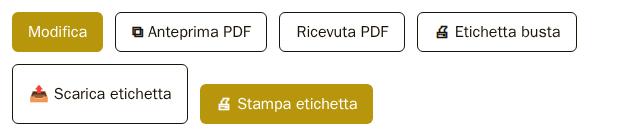
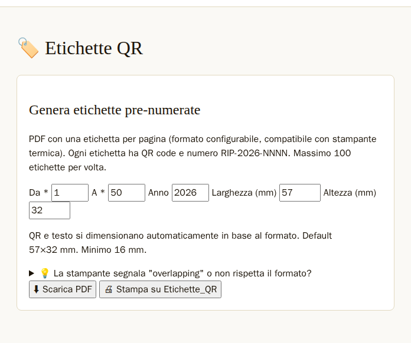
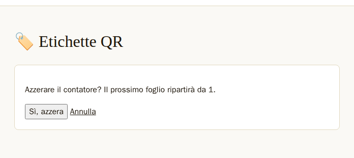
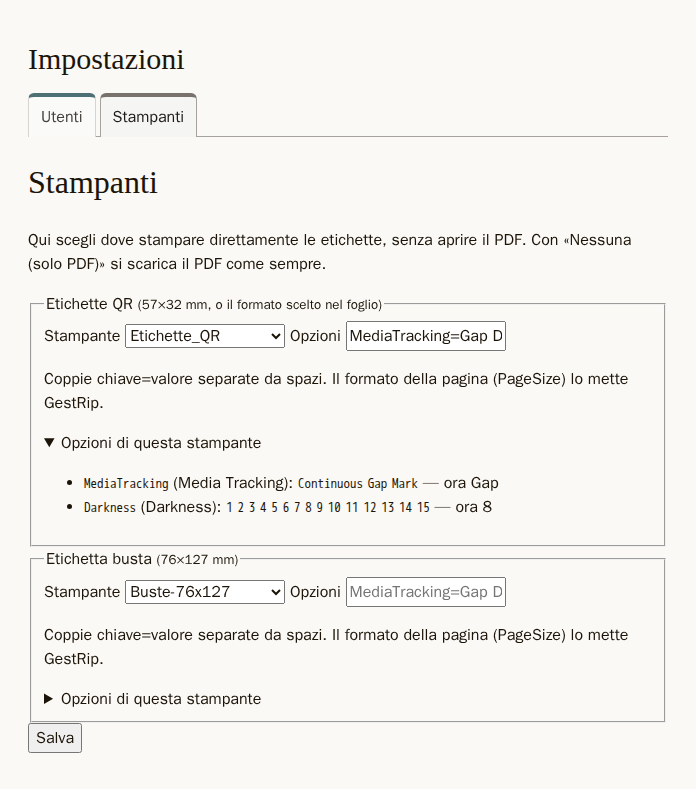
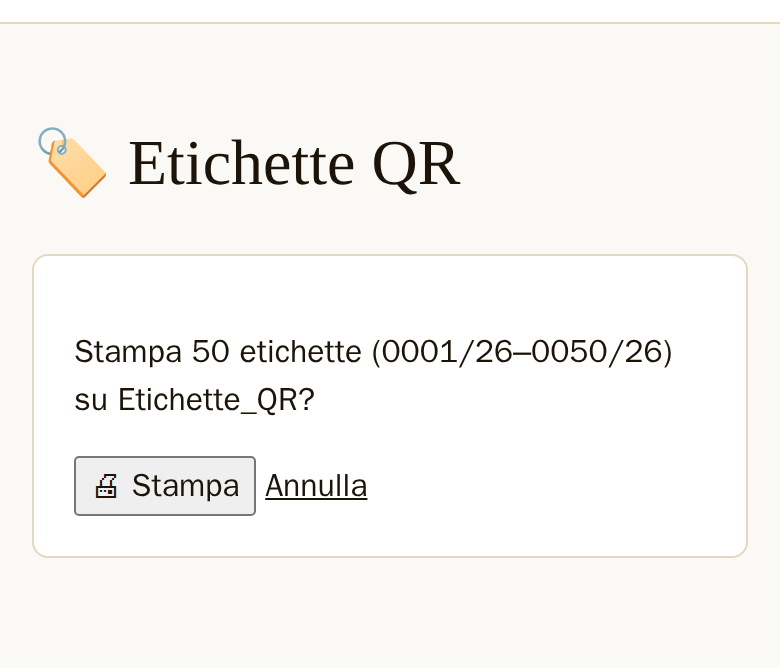
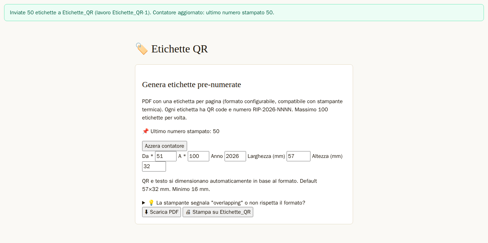

# Stampe ed etichette

GestRip prepara i documenti da stampare come file PDF: la ricevuta per il cliente, la scheda della
busta, l'etichetta da attaccare alla busta, il report di più schede e i fogli di etichette QR. Un PDF
si apre, si scarica o si stampa come ogni altro documento. Le etichette si possono anche mandare
direttamente alla stampante, senza aprire il PDF: è la **stampa diretta**, spiegata più sotto.

Titolare e dipendente possono fare tutte le stampe. Solo il titolare sceglie le stampanti e azzera il
contatore delle etichette QR.

Su tutti i PDF di una busta (ricevuta, scheda PDF, etichetta della busta, report) il numero della
busta è quello dell'**etichetta QR** attaccata alla busta, per esempio «0045/26». Un'etichetta riusata
dell'anno prima porta il suo anno, per esempio «0045/25». Se la busta non ha un'etichetta QR, il
programma scrive il suo numero interno con «N.» davanti, per esempio «N. 45/26». Il nome del file
scaricato resta quello del numero interno, per esempio «ricevuta-45-26.pdf».

## I pulsanti della scheda

Nella scheda della busta, sotto i dati, c'è una fila di pulsanti per le stampe.

*Figura 4.1 — I pulsanti della scheda: «🖨 Stampa etichetta» c'è solo se il titolare ha scelto una stampante per l'etichetta busta.*

- «⧉ Anteprima PDF» apre la scheda PDF in una nuova scheda del browser.
- «Ricevuta PDF» scarica la ricevuta per il cliente.
- «🖨 Etichetta busta» apre l'etichetta della busta in una nuova scheda del browser, pronta da
  stampare.
- «📤 Scarica etichetta» scarica lo stesso PDF dell'etichetta come file.
- «🖨 Stampa etichetta» manda l'etichetta direttamente alla stampante. C'è solo se il titolare ha
  scelto una stampante per l'etichetta busta (vedi «La scheda Stampanti»).

## La ricevuta

La ricevuta è il foglio da dare al cliente quando lascia l'oggetto. È larga 80 mm, come lo scontrino
di una stampante a rotolo, e alta 297 mm. Se il testo è lungo, la ricevuta continua su un'altra pagina
della stessa misura.

La ricevuta contiene il nome del negozio, il numero della busta («Busta 0045/26», oppure «Busta N.
45/26» per una busta senza etichetta), il cliente e il telefono, la data
ricezione (sulla ricevuta «ACCETTATA») e la consegna prevista («PREVISTA»), le due date nella forma
giorno/mese/anno (per esempio «05/09/2026»), la lavorazione, le note visibili al
cliente e gli importi (preventivo e prezzo finale, se ci sono). In fondo dice «Conservare questa ricevuta per il ritiro.».

Se la busta non ha una data di consegna prevista, la ricevuta scrive «Da concordare». Le note interne
non vanno mai sulla ricevuta.

## La scheda PDF

La scheda PDF è il riepilogo completo della busta, su un foglio di 100×230 mm. In alto a destra, sotto
«N° BUSTA», c'è il numero della busta («0045/26», oppure «N. 45/26» senza etichetta). Contiene i dati
della busta nell'ordine della scheda (prima la «Data ricezione» e la «Data consegna prevista»), le note
visibili al cliente e anche le note interne (su uno sfondo giallo chiaro), il preventivo e gli spazi
«Firma artigiano» e «Firma cliente».

Se la busta è una scheda Compro Oro, la scheda PDF ha anche la «Ricevuta di deposito per valutazione».

Se la busta ha la firma di consegna, la scheda PDF ha in fondo il riquadro «Consegna — Firma del
cliente», con la frase che il cliente ha firmato, quando ha firmato, chi ha ritirato e l'immagine
della firma. Vale anche per le firme che arrivano dal vecchio programma.

Se il testo non sta in una pagina, la scheda continua sulle pagine dopo.

## L'etichetta della busta

L'etichetta della busta è grande 76×127 mm e si attacca alla busta di carta. Contiene:

- «→» e il nome dell'artigiano in maiuscolo, se la busta ha un artigiano;
- il numero della busta, grande, per esempio «#0045/26»; per una busta senza etichetta QR «N. 45/26»
  (da «N. 1000/26» in su il numero va su due righe, «N.» sopra e il numero sotto);
- un codice QR: contiene il codice QR della busta o, se la busta non ce l'ha, il numero interno della
  busta;
- «All'artigiano:» con la data del giorno in cui si stampa l'etichetta, cioè il giorno in cui la busta
  parte verso l'artigiano;
- «Scad.:» con la consegna prevista, se c'è: la data nella forma giorno/mese/anno («20/11/2026»),
  oppure il testo scritto al posto della data («fine mese»);
- lo stato della busta in un riquadro nero;
- la lavorazione, tagliata dopo circa 180 caratteri con «…»; se la lavorazione è vuota c'è «—»;
- la casella «FATTO», «Note:» e tre righe per scrivere a mano.

Il codice QR è stampato diritto.

## Quello che vale per tutti i PDF

Nei PDF un carattere che il programma non sa disegnare, come un'emoji o un ideogramma, esce come «�».

La scheda PDF usa lo stesso tipo di carattere degli altri PDF di GestRip. Per questo gli a capo
possono cadere in punti un po' diversi da quelli del vecchio programma.

Se GestRip non riesce a preparare un PDF, al posto del documento compare «PDF non disponibile».

## Il report di più schede

Il report mette in un solo PDF, in formato A4, le schede di più buste: una pagina per busta. Ogni
scheda comincia con il numero della busta, per esempio «#0045/26» o «N. 45/26». Solo la
prima pagina ha in testa il nome del negozio, «Schede riparazioni», la data e il numero di schede. In
fondo a ogni pagina c'è «Generato da» con il nome del negozio, «uso interno», e il numero della
pagina.

Un report contiene al massimo 50 buste. Se se ne chiedono di più, al posto del PDF compare «Troppe
riparazioni per un solo report: N selezionate, il massimo è 50. Restringi la selezione.».

Il report non contiene le foto.

Oggi nel programma nessuna pagina ha ancora il pulsante che apre il report: la lista delle buste,
da cui si scelgono, non c'è ancora.

## Le etichette QR prenumerate

Le etichette QR sono piccole etichette con un codice QR e un numero, stampate prima, a fogli, e
attaccate alle buste quando servono. Si preparano dal menu ☰ → «🏷️ Etichette QR».

*Figura 4.2 — Il modulo «Etichette QR»: i numeri da stampare, l'anno, la misura, «⬇ Scarica PDF» e «🖨 Stampa su …».*

Nel modulo si scelgono:

- «Da» e «A»: il primo e l'ultimo numero del foglio, da 1 a 9999;
- «Anno»: l'anno delle etichette, da 2024 a 2099;
- «Larghezza (mm)» e «Altezza (mm)»: la misura di un'etichetta, da 16 a 200 mm. All'inizio è
  57×32 mm; poi il modulo propone l'ultima misura usata.

Il programma propone i numeri dopo l'ultimo stampato: «Da» è l'ultimo numero più 1, «A» è l'ultimo
numero più 50. Per esempio, se l'ultimo numero stampato è 50, propone da 51 a 100. L'ultimo numero
stampato è scritto nel modulo, per esempio «📌 Ultimo numero stampato: 50».

Un foglio contiene al massimo 100 etichette. Se se ne chiedono di più, il modulo torna con «Massimo
100 etichette per volta: hai chiesto N.».

Il PDF ha un'etichetta per pagina. Sotto ogni codice QR c'è il numero nella forma «0045/26»: quattro
cifre, la barra e le ultime due cifre dell'anno. Il codice QR contiene «RIP-2026-0045».

Anche le etichette piccole, fino al minimo di 16 mm, hanno il codice QR e il numero interi. Se il
lato più corto dell'ultima misura usata è sotto i 20 mm, il modulo avvisa: «⚠ Formato piccolo: il QR potrebbe essere difficile
da scansionare con cellulari datati o luce scarsa.». L'avviso guarda la misura proposta quando si
apre il modulo, cioè l'ultima usata, non quella che si sta scrivendo.

Sotto il modulo c'è un aiuto, «💡 La stampante segnala "overlapping" o non rispetta il formato?», con
qualche consiglio per quando l'etichetta stampata non viene della misura giusta.

## Il contatore delle etichette

GestRip ricorda l'ultimo numero stampato: è il **contatore** delle etichette. Il contatore è uno solo,
non uno per anno.

«⬇ Scarica PDF» scarica il foglio e aggiorna subito il contatore. Non c'è nessuna domanda di
conferma. Se un foglio non è uscito bene, si ristampano gli stessi numeri cambiando «Da» e «A» a mano.

Ristampare numeri vecchi non riporta indietro il contatore. Per esempio, se l'ultimo numero stampato è
100 e si ristampano le etichette da 1 a 10, il contatore resta 100.

Il titolare può azzerare il contatore con «Azzera contatore». Il pulsante c'è solo quando il
contatore è sopra 0. Si apre una pagina con la domanda
«Azzerare il contatore? Il prossimo foglio ripartirà da 1.», con «Sì, azzera» e «Annulla». Il
contatore si azzera solo con «Sì, azzera», e compare «Contatore azzerato: il prossimo foglio parte da
1.». Dopo l'azzeramento il contatore è 0 e il modulo propone i numeri da 1 a 50.

*Figura 4.3 — La domanda dell'azzeramento: il contatore si azzera solo con «Sì, azzera».*

Il dipendente vede il contatore ma non il pulsante «Azzera contatore».

## Il nuovo anno

A inizio anno, o a fine dicembre quando si prepara il foglio dell'anno dopo, le etichette di solito
ripartono da 1. GestRip lo propone da solo.

La proposta compare in due posti, sempre solo se il contatore non è a zero.

Nel modulo, appena aperto, la proposta compare quando l'anno di oggi è più nuovo dell'anno
dell'ultimo foglio stampato: per esempio il primo foglio di gennaio. Il titolare vede «Nuovo anno:
ripartire da 1?» con «Azzera contatore». Il dipendente vede «Nuovo anno: chiedi al titolare di
azzerare il contatore, così il prossimo foglio riparte da 1.».

Quando si chiede un foglio con un anno più nuovo di quello dell'ultimo foglio stampato, per esempio a
fine dicembre scrivendo a mano l'anno dopo in «Anno», prima del PDF compare una pagina intermedia con
i numeri chiesti e l'ultimo numero stampato dell'anno prima, e la stessa proposta. Il titolare può azzerare oppure scegliere «Continua senza
azzerare: scarica il PDF». Il dipendente può scegliere «Continua: scarica il PDF». «← Torna al modulo»
riporta al modulo.

Dopo l'azzeramento il modulo riparte da 1 e la proposta non ricompare per quell'anno. Se un PDF era già
stato preparato con i numeri vecchi, va rifatto.

Se GestRip non conosce l'anno dell'ultimo foglio stampato, per esempio subito dopo il passaggio dal
vecchio programma, non propone niente.

## La scheda «Stampanti»

La stampa diretta manda un documento alla stampante senza aprire il PDF. Per usarla, il titolare
sceglie prima le stampanti in ☰ → «Impostazioni» → «Stampanti». Il dipendente non vede questa pagina.

*Figura 4.4 — Impostazioni → Stampanti: una stampante per le etichette QR, con due opzioni, e una per l'etichetta busta.*

La pagina ha un riquadro per ogni documento che si può stampare direttamente: «Etichette QR» (57×32
mm, o la misura scelta nel foglio) ed «Etichetta busta» (76×127 mm).

In ogni riquadro, «Stampante» elenca le **code di stampa** del computer su cui gira GestRip (una per
stampante), più «Nessuna (solo PDF)». «Nessuna (solo PDF)» è la scelta iniziale: con questa scelta quel documento si scarica in PDF
come sempre, e il pulsante della stampa diretta non c'è.

In «Opzioni» si possono scrivere le impostazioni della stampante, nella forma chiave=valore, separate
da spazi. Per esempio, su una stampante di etichette, «MediaTracking=Gap Darkness=8» sceglie come la
stampante trova lo spazio tra un'etichetta e l'altra e quanto scura è la stampa. Le opzioni dipendono
dalla stampante. Il campo vuoto mostra in grigio un esempio: con una stampante scelta, due opzioni di
quella stampante con il loro valore di adesso; senza, un esempio diverso per le etichette QR e per
l'etichetta busta. «Opzioni di questa stampante» elenca le opzioni
che la stampante accetta, con il valore di adesso.

La misura della pagina non va scritta nelle opzioni: la mette GestRip, dalla misura del documento. Se
un'opzione non è accettata, sotto il campo compare «Opzione non valida:» con il motivo.

«Salva» salva le scelte e compare «Stampanti salvate.».

Se il sistema di stampa del computer non risponde, la pagina lo dice in rosso: «Le stampanti non
rispondono. L'elenco delle stampanti non c'è. Le scelte salvate restano; puoi sempre scegliere «Nessuna (solo
PDF)».». In quel caso si può tenere la stampante già salvata, ma non sceglierne una nuova.

Se GestRip è stato avviato senza la stampa diretta, la pagina dice in rosso «Stampa diretta non
disponibile: GestRip è partito senza i comandi delle stampanti.» e si può scegliere solo «Nessuna (solo PDF)».

Se una stampante salvata non c'è più nel computer, nell'elenco compare con «(non trovata nel computer)».

Le stampanti con un nome che contiene spazi o caratteri diversi da lettere, cifre e «_ . - @» non si
possono scegliere: la pagina le elenca a parte.

## Stampare le etichette QR direttamente

Con una stampante scelta per le etichette QR, nel modulo c'è anche «🖨 Stampa su» con il nome della
stampante. Il pulsante apre una domanda, per esempio «Stampa 50 etichette (0001/26–0050/26) su
Etichette_QR?», con «🖨 Stampa» e «Annulla».

*Figura 4.5 — La domanda prima della stampa diretta: «🖨 Stampa» manda il foglio alla stampante, «Annulla» torna al modulo.*

Se la stampante accetta il lavoro, il contatore si aggiorna e il modulo torna con un messaggio, per
esempio «Inviate 50 etichette a Etichette_QR (lavoro Etichette_QR-1). Contatore aggiornato: ultimo
numero stampato 50.».

*Figura 4.6 — Dopo la stampa: in alto il messaggio «Inviate 50 etichette…», sotto l'ultimo numero stampato e i numeri proposti per il foglio dopo.*

Se la stampa non riesce, il contatore non cambia. Il modulo torna con «Stampa non riuscita:», il
motivo e «Il contatore non è cambiato: puoi riprovare, oppure scaricare il PDF.». I motivi possibili:

- «la stampante non risponde.»: il sistema di stampa del computer è spento o bloccato;
- «la stampante ha rifiutato il lavoro.», a volte con il motivo tra parentesi: la stampante non ha
  accettato il foglio;
- «la stampante non ha risposto in tempo. Il lavoro potrebbe essere partito lo stesso: controlla la
  stampante prima di riprovare.»: in questo caso il foglio potrebbe uscire lo stesso, quindi prima di riprovare
  si guarda la stampante.

Se il foglio è di un anno nuovo, la proposta «Nuovo anno: ripartire da 1?» compare nella stessa
domanda, e il pulsante dice «Continua senza azzerare: 🖨 Stampa» (per il dipendente «Continua: 🖨
Stampa»).

Un doppio tocco su «🖨 Stampa» non stampa due volte. Se un foglio uguale è già in stampa, per esempio
da un'altra scheda del browser, compare «Stampa già in corso: aspetta l'esito prima di riprovare.».

## Stampare l'etichetta della busta direttamente

Con una stampante scelta per l'etichetta busta, nella scheda c'è «🖨 Stampa etichetta». Il pulsante
manda l'etichetta 76×127 mm direttamente alla stampante, senza domanda.

Se la stampante accetta il lavoro, la scheda dice «Etichetta inviata a» con il nome della stampante e
il numero del lavoro. Se la stampa non riesce, la scheda dice «Etichetta non stampata:», il motivo
(gli stessi delle etichette QR) e «Puoi aprire il PDF con «🖨 Etichetta busta».».

Anche qui un doppio tocco non stampa due volte.
