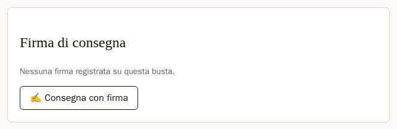
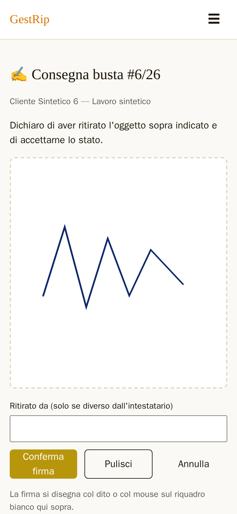
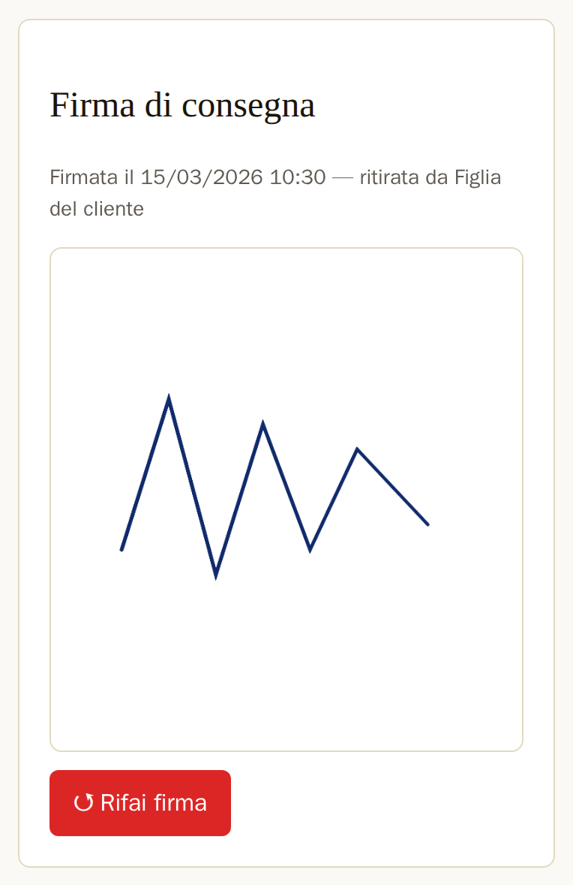

# Firma di consegna

Quando il cliente ritira l'oggetto, può firmare sul telefono del negozio (o sul computer, col mouse).
La firma registra la consegna: la busta passa allo stato «Consegnata» nello stesso momento. Titolare e
dipendente possono far firmare il cliente. Solo il titolare può rifare una firma già registrata.

## Quando si può firmare

Nella scheda della busta c'è il riquadro «Firma di consegna». Se la busta non ha ancora una firma, il
riquadro dice «Nessuna firma registrata su questa busta.» e, se la busta si può consegnare, ha il
pulsante per firmare.

*Figura 5.1 — Una busta pronta senza firma: «✍️ Consegna con firma» apre la pagina di firma.*

Su una busta pronta il pulsante dice «✍️ Consegna con firma». Per una scheda Compro Oro vale lo
stesso quando la busta è nello stato «Perfezionata».

Su una busta già consegnata (o già chiusa, per il Compro Oro) il pulsante dice «✍️ Aggiungi firma».
La firma si aggiunge e la consegna resta quella registrata prima, con la sua data.

Una busta in un altro stato non si può firmare: per esempio una busta in lavorazione, in attesa di
materiali o annullata. Lì il pulsante non c'è. Se qualcuno apre lo stesso la pagina di firma, torna
alla scheda con «Questa busta non può essere consegnata da dove si trova: firma non disponibile.».

## La pagina di firma

La pagina di firma ha il titolo «✍️ Consegna busta» con il numero, il nome del cliente e la
lavorazione. Sotto c'è la frase che il cliente firma: «Dichiaro di aver ritirato l'oggetto sopra
indicato e di accettarne lo stato.».

*Figura 5.2 — La pagina di firma: il cliente firma col dito nel riquadro bianco, poi si preme «Conferma firma».*

Il cliente firma col dito nel riquadro bianco grande. Sul computer si firma col mouse, tenendo premuto
il tasto. Se si gira il telefono dopo aver firmato, la firma resta.

«Ritirato da (solo se diverso dall'intestatario)» si riempie solo se a ritirare non è la persona
intestataria della busta, per esempio un familiare. Il campo tiene al massimo 120 caratteri.

«Pulisci» cancella il riquadro e si ricomincia a firmare. «Annulla» torna alla scheda senza
registrare niente.

Le altre pagine di GestRip hanno in basso a destra il pulsante «🏠 Lista», che porta alla pagina
iniziale. La pagina di firma non ce l'ha: sul riquadro non c'è niente che si possa toccare per
sbaglio.

## Confermare la firma

«Conferma firma» registra la firma e consegna la busta. La scheda si riapre con «Firma registrata:
riparazione consegnata.».

Una busta di riparazione passa allo stato «Consegnata». Una scheda Compro Oro passa allo stato
«Chiusa». Se la busta non aveva ancora la data di consegna, prende quella di oggi.

Se il riquadro è vuoto, «Conferma firma» non parte: il browser apre una finestra con «Firma
mancante.» e il pulsante «OK». Lo stesso succede se il
riquadro è stato toccato una volta sola senza disegnare, o se dopo «Pulisci» non si è firmato di nuovo.

Se la firma arriva al server rovinata, la pagina di firma si riapre con «Firma mancante o non
valida.» e si firma di nuovo.

Una busta ha una firma sola. Se due persone confermano la firma della stessa busta quasi insieme, vale
la prima; la seconda torna alla scheda con «La firma è già stata registrata su questa busta.».

## La firma nella scheda

Dopo la firma, il riquadro «Firma di consegna» della scheda mostra quando è stata fatta la firma, chi
ha ritirato e l'immagine della firma.

*Figura 5.3 — La firma registrata: data e ora, chi ha ritirato, l'immagine e, per il titolare, «↺ Rifai firma».*

La riga in alto dice, per esempio, «Firmata il 15/03/2026 10:30 — ritirata da Figlia del cliente». Se
«Ritirato da» era vuoto, la parte «— ritirata da» non c'è. Per alcune firme arrivate dal vecchio
programma la data non è nota, e la riga dice «Firmata (data non registrata)».

La firma la vede solo il personale del negozio. Il cliente e l'artigiano non la vedono mai dal loro
link.

La firma va anche nella scheda PDF, nel riquadro «Consegna — Firma del cliente» (capitolo 4).

## Rifare la firma

Solo il titolare ha «↺ Rifai firma». Il pulsante chiede «Cancellare la firma e rifarla? La consegna
resta registrata.». Con «OK» la firma si cancella e si apre la pagina di firma con «Firma azzerata:
puoi rifirmare.». Con «Annulla» non cambia niente.

Dopo «↺ Rifai firma» la busta resta consegnata, con la sua data di consegna. La firma vecchia non
sparisce del tutto: resta conservata nel registro delle firme.

Il dipendente non vede «↺ Rifai firma». Se serve rifare una firma, lo chiede al titolare.
