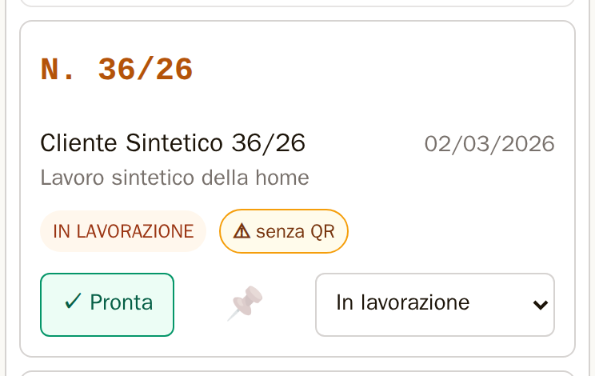
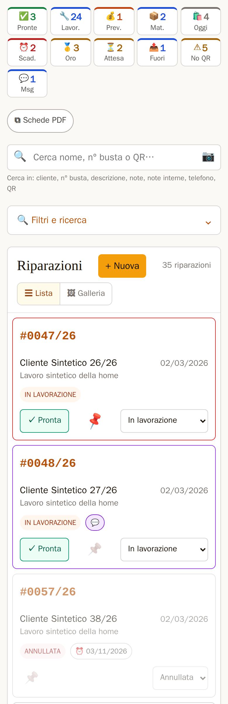
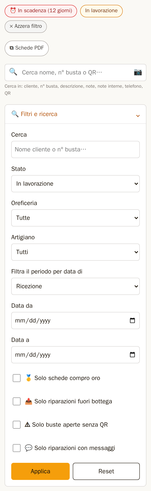
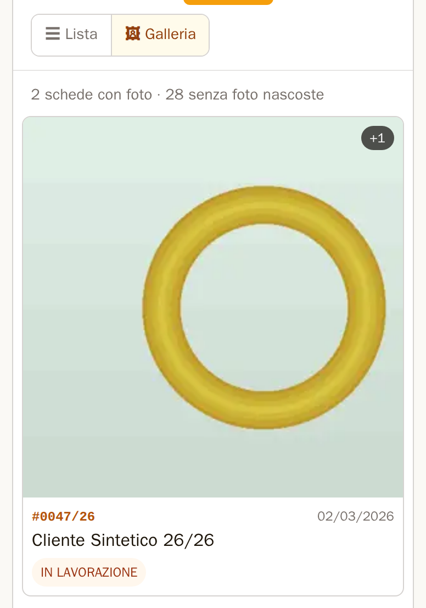
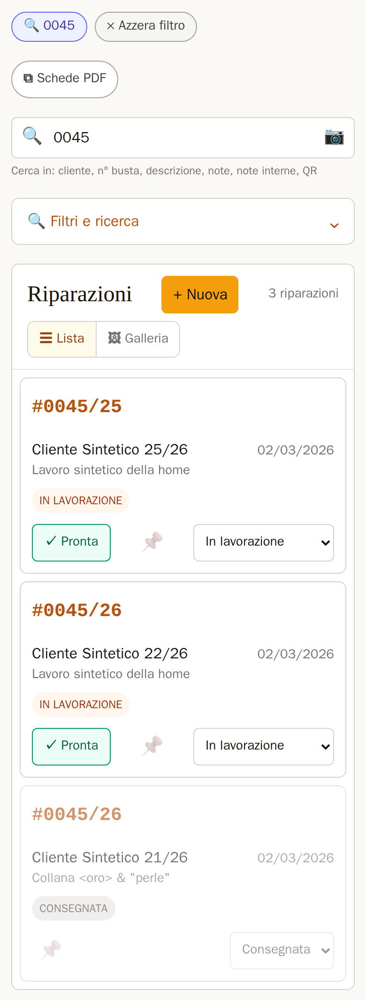
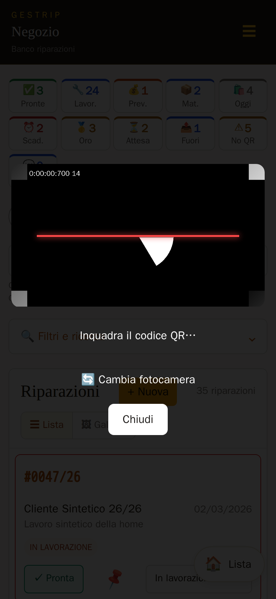
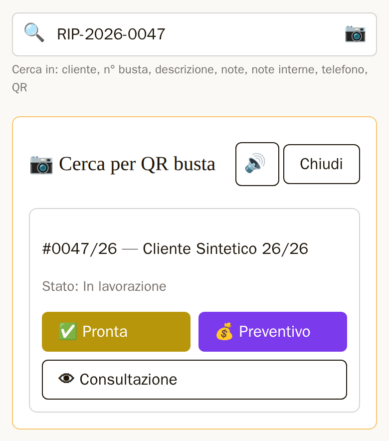
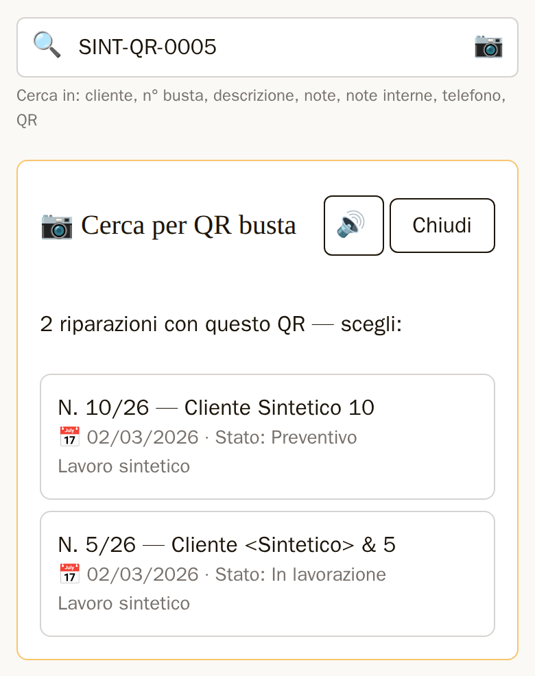
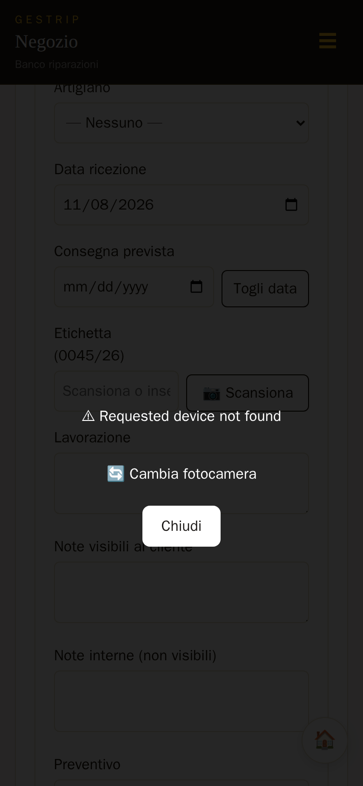

# La lista, la ricerca e il QR

La prima pagina di GestRip è la **lista delle riparazioni**: in alto i contatori, sotto il campo per
cercare e per leggere le etichette QR, poi le buste. Da qui si trova una busta, si cambia il suo stato
e la si apre. Titolare e dipendente usano la lista allo stesso modo.

Le schermate di questo capitolo sono prese con dati inventati: nomi, numeri e codici non sono di
clienti veri, e la fotocamera è quella finta del browser di prova (un disegno colorato, non un QR).

## Il numero delle buste

Ogni busta mostra il numero della sua **etichetta QR**, nella forma «#0045/26». Un'etichetta riusata
dell'anno prima tiene il suo anno: «#0045/25».

Una busta senza etichetta mostra il numero interno, «N. 45/26», che non si confonde con un'etichetta.
Se è aperta porta anche il segno **«⚠ senza QR»**: è una busta a cui manca l'etichetta. Il segno c'è
anche sulle buste che hanno un QR di un **altro formato**, per esempio un codice vecchio scritto a mano
o di un altro programma: per GestRip non sono etichette. Sul computer, tenendo il mouse sul segno, il
titolo dice quale dei due casi è: «Busta senza codice QR: aggiungilo dalla scheda» oppure «Busta senza
etichetta RIP: il suo QR è di un altro formato».

*Figura 6.1 — Una busta con un QR di altro formato: si vede il numero interno «N. 36/26» e il segno «⚠ senza QR».*

Il riquadro «⚠ Senza QR» in alto e il filtro «⚠ Solo buste aperte senza QR» contano invece solo le
buste **senza nessun codice**, non quelle con un QR di altro formato.

## La lista

*Figura 6.2 — La lista sul telefono: i contatori in alto, il campo unico con 🔍 e 📷, il cassetto dei filtri chiuso e le prime buste.*

### I contatori in alto

I riquadri in alto contano le buste: «Pronte», «In lavorazione», «Preventivi», «In attesa mat.»,
«Consegnate oggi», «In scadenza» e «Compro oro»; poi «⏳ In attesa» (buste in attesa di una risposta
del cliente), «📤 Fuori bottega» e «⚠ Senza QR», che compaiono solo quando contano qualcosa, e «💬
Messaggi». Toccando un riquadro la lista mostra solo quelle buste.

### Le buste

Ogni busta della lista è un riquadro con il numero, il cliente, la data, la descrizione e i segni:

- lo stato («In lavorazione», «Pronta»…), l'oreficeria, «🪙 Compro Oro»;
- «⏳ 3gg» se la busta aspetta una risposta del cliente da 3 giorni (il motivo è nel titolo);
- «⏰» con la data di consegna prevista, in rosso quando è vicina o passata;
- 💬 per un messaggio del cliente non letto, 🗨 per una conversazione già letta, 🤝 per un
  preventivo accettato o rifiutato dal cliente e non ancora visto;
- «⚠ senza QR» (vedi sopra).

Toccando il riquadro si apre la scheda della busta. Le buste consegnate e annullate sono più chiare.

In cima alla lista ci sono le buste fissate con il 📌, poi quelle con un messaggio non letto, poi le
altre. Le buste sono 30 per pagina: in fondo «← Precedente» e «Successiva →».

### I pulsanti di ogni busta

A destra di ogni busta ci sono i pulsanti per le azioni più comuni, senza aprire la scheda:

- **«✓ Pronta»**, su una busta in lavorazione: la segna pronta e apre la scheda sul prezzo finale.
- **«✓ Consegnata»**, su una busta pronta: chiede «Segnare la busta 0045/26 come consegnata?» e, con
  OK, la segna consegnata. Si resta sulla lista, con il messaggio «Stato aggiornato.».
- Preventivi, buste in attesa materiali e Compro Oro non hanno i pulsanti rapidi: si usa il menu.
- **Il menu dello stato** mostra lo stato di adesso e offre solo i passi consentiti per quella busta:
  scelto un passo, lo stato cambia subito. Una busta consegnata o annullata ha il menu spento: si
  riapre dalla scheda.
- **📌** («Pinna in cima») tiene la busta in testa alla lista; lo stesso 📌 («Togli pin») la rimette
  al suo posto.

Dopo un'azione la lista resta allo stesso punto e il messaggio compare in cima allo schermo:
toccandolo si chiude.

### Tornare alla lista

«← Indietro» della scheda e di «Nuova riparazione» torna alla lista da cui si è partiti, con i suoi
filtri e la sua pagina.

## I filtri e le pillole

«🔍 Filtri e ricerca», sotto il campo di ricerca, apre il **cassetto dei filtri**: lo stato,
l'oreficeria, l'artigiano, il periodo (per data di «Ricezione», «Pronta», «Consegna» o «Consegnata»,
con «Data da» e «Data a») e le spunte «🥇 Solo schede compro oro», «📤 Solo riparazioni fuori bottega»,
«⚠ Solo buste aperte senza QR» e «💬 Solo riparazioni con messaggi». «Applica» li mette, «Reset» li
toglie tutti.

I filtri attivi si vedono come **pillole** sopra la lista, per esempio «⏰ In scadenza (12 giorni)»,
«In lavorazione» o «📅 Ricezione: 2026-01-01 → …». «× Azzera filtro» le toglie tutte e torna alla
lista intera. «⧉ Schede PDF» fa il PDF delle schede della lista filtrata (capitolo 4).

*Figura 6.3 — I filtri «In scadenza» e «In lavorazione» come pillole, e il cassetto «🔍 Filtri e ricerca» aperto.*

## La galleria

Sopra la lista, «☰ Lista» e «🖼 Galleria» cambiano vista tenendo i filtri (la pagina riparte dalla
prima).

La galleria mostra, per le buste della pagina che hanno delle foto, la prima foto con «+2» se ce ne
sono altre due, e sotto numero, data, cliente e stato. Toccando la foto si apre la scheda con quella
foto grande; toccando i dati si apre la scheda.

In cima dice quante schede hanno foto e quante senza foto sono nascoste. Se nella pagina nessuna busta
ha foto, dice «Nessuna scheda con foto trovata.».

Pagine, filtri, ricerca, «⧉ Schede PDF» e «← Indietro» della scheda restano nella galleria; «× Azzera
filtro» e i riquadri in alto tornano alla lista. La grandezza delle foto (piccola, media, grande) è
un'impostazione del negozio.

*Figura 6.4 — La galleria sul telefono: «☰ Lista / 🖼 Galleria», quante schede hanno foto e la prima cella, con «+1» per la seconda foto.*

## Il campo unico: cercare e leggere le etichette

In alto nella lista c'è un solo campo, «Cerca nome, n° busta o QR…», con 🔍 a sinistra e 📷 a destra.
Serve per cercare una busta scrivendo e per leggere l'etichetta QR di una busta, con la fotocamera o con
il lettore a pistola. I filtri già scelti restano. In «Nuova riparazione» il campo non c'è: lì il 📷
sta accanto all'etichetta (più sotto).

### Cercare scrivendo

- Si scrive e si preme 🔍 (o Invio).
- Un numero d'etichetta («0045/26», «0045», «45»): escono **sempre tutte** le buste con quell'etichetta,
  anche chiuse e consegnate, qualunque filtro sia attivo. Con un risultato si apre la scheda, con più
  di uno la lista.
- Insieme escono anche le buste **senza etichetta** con quel numero interno (per esempio la busta
  «N. 45/26», scrivendo «45/26» o «45»): sono segnate «⚠ senza QR», anche se sono chiuse, con il
  titolo «Busta senza etichetta: trovata con il numero interno». Senza l'anno («45», «0045») valgono
  tutti gli anni, come per le etichette.
- Con un numero da 1 a 4 cifre la ricerca guarda solo le etichette e i numeri interni, non il
  telefono: per questo la riga sotto il campo, mentre si scrive un numero così, non dice «telefono».
- Le altre ricerche (nome, telefono, descrizione, note) tengono i filtri attivi: con un risultato si
  apre la scheda, con più di uno la lista filtrata.

*Figura 6.5 — La ricerca «0045»: le due buste con l'etichetta 0045/26 (una consegnata) e quella con l'etichetta dell'anno prima, 0045/25.*

### Leggere un'etichetta con la fotocamera

1. Tocca 📷 nel campo di ricerca. Si apre una finestra scura con il video della fotocamera posteriore
   e una **linea rossa di mira** a metà: è solo un aiuto per puntare, il codice si legge anche fuori
   dalla linea.
2. Inquadra il QR dell'etichetta. Appena il codice è letto la finestra si chiude da sola.
3. Il riquadro «📷 Cerca per QR busta» si apre **sopra la lista**, senza cambiare pagina: la lista e i
   filtri restano sotto.

*Figura 6.6 — La finestra della fotocamera, dopo «🔄 Cambia fotocamera»: il video con la linea rossa di mira, «Inquadra il codice QR…», «🔄 Cambia fotocamera» e «Chiudi». Qui il video è il disegno della fotocamera finta del browser di prova.*

Nella finestra della fotocamera:

- «🔄 Cambia fotocamera» passa alla fotocamera posteriore successiva, sui telefoni che ne hanno più
  di una. Il telefono ricorda la scelta per le volte dopo. Con una sola fotocamera la finestra dice
  «Una sola fotocamera disponibile.».
- «Chiudi» (o Esc sul computer) chiude la finestra senza leggere niente.

Il programma prova da solo la fotocamera principale: su alcuni telefoni con più obiettivi la prima
fotocamera aperta è il teleobiettivo, che mette a fuoco solo da lontano.

Il lettore legge anche i QR stampati **a specchio** delle etichette fatte con il programma di prima:
non serve girarle né ristamparle.

#### Il permesso della fotocamera

La prima volta il browser chiede se GestRip può usare la fotocamera: rispondi «Consenti». Se per
sbaglio hai risposto di no, la finestra mostra l'errore del browser; il permesso si rimette dalle
impostazioni del sito nel browser (il lucchetto accanto all'indirizzo).

#### Serve una connessione sicura

La fotocamera funziona solo se GestRip è aperto con un indirizzo sicuro (`https://`, con il
certificato del negozio installato sul telefono). Altrimenti la finestra dice «⚠ Fotocamera non
disponibile: contesto non sicuro (HTTP o certificato non valido), il browser non espone la
fotocamera.»: non è un guasto del programma, è il browser che non dà la fotocamera. Se il telefono o
il browser non hanno una fotocamera, il messaggio è «⚠ Fotocamera non disponibile su questo
dispositivo o browser.».

### Leggere un'etichetta con il lettore a pistola

Tocca il campo di ricerca (il testo già scritto si seleziona) e spara sull'etichetta: il lettore
scrive il codice e preme Invio da solo.

- Se il codice è quello di una busta, il riquadro si apre sopra la lista come con la fotocamera.
- Se il codice è un'etichetta («RIP-2026-0045») che non è di nessuna busta, esce la lista vuota e il
  programma suona **i due bip gravi**, come con la fotocamera.
- Un testo che non è un'etichetta conta come una ricerca scritta, senza suono.

### Il riquadro della busta

*Figura 6.7 — Il riquadro «📷 Cerca per QR busta» sopra la lista: la busta, il suo stato, il passo successivo, 🔊 e «Chiudi».*

- Se l'etichetta è su una sola busta aperta, il riquadro mostra quella busta: numero, cliente, stato e
  il passo successivo.
- Se l'etichetta è su più buste aperte, o solo su buste chiuse, il riquadro dice «N riparazioni con
  questo QR — scegli:»: tocca la busta giusta e il riquadro mostra quella, sempre sopra la lista.
- Se nessuna busta ha quel codice: «⚠️ Nessuna riparazione trovata per questo QR».
- «Chiudi» (o Esc sul computer) toglie il riquadro: la lista è ancora lì.

*Figura 6.8 — Un codice QR (qui di altro formato) su due buste aperte: «2 riparazioni con questo QR — scegli:».*

Il riquadro propone il passo successivo della busta:

- «✅ Pronta», «▶ In lavorazione», «✅ Consegnata»; per il Compro Oro «✅ Valutata», «✅ Perfezionata»,
  «✅ Chiusa».
- «💰 Preventivo» mette la busta in preventivo e apre la scheda sul preventivo; «✅ Pronta» apre la
  scheda sul prezzo finale.
- Consegna, valutazione e perfezionamento chiedono conferma nel riquadro: «Sì» conferma, «Annulla»
  torna ai pulsanti.
- Dopo le altre azioni compare «✓ consegnata» (o lo stato nuovo) e si torna alla lista con i filtri di
  prima.
- Se la busta è ancora dall'artigiano, la conferma lo dice e la busta risulta anche rientrata.
- Una busta consegnata, annullata o chiusa ha solo «👁 Consultazione».
- Se qualcun altro ha appena cambiato la stessa busta, il riquadro dice «Stato cambiato nel frattempo:
  ricontrolla.» e mostra i pulsanti giusti per lo stato di adesso.
- Dopo «✅ Valutata» il messaggio WhatsApp al cliente non parte ancora: arriva con gli avvisi.

### Il suono

Sul telefono (e sul computer con le casse accese) il programma suona l'esito della lettura:

- **un bip acuto** quando la busta è trovata o l'azione è fatta;
- **due bip gravi** quando il codice non è di nessuna busta o l'azione è rifiutata.

Dove il telefono lo permette (Android) vibra anche. L'esito lo decide il programma dopo aver cercato la
busta, non la sola lettura: un codice letto bene ma sconosciuto suona i due bip gravi, con la
fotocamera e con il lettore a pistola.

Il suono parte solo dopo che hai toccato 📷 almeno una volta sulla pagina: è una regola dei telefoni e
dei browser. Per questo un codice scritto a mano dal computer, o letto con la pistola senza aver mai
toccato 📷, resta muto. Con il lettore a pistola, dopo aver aperto (o ricaricato) GestRip tocca 📷 e
poi «Chiudi»: da lì in poi, finché la pagina resta aperta, anche la pistola suona.

Nel riquadro c'è l'interruttore 🔊/🔇: spegne e riaccende i suoni del QR **su quel telefono o
computer** (gli altri non cambiano), anche quelli della pistola. Riaccendendolo suona un bip di prova.
Su iPhone, con l'interruttore laterale del silenzioso attivo, il suono può non sentirsi sui modelli più
vecchi.

## In «Nuova riparazione» e nella modifica della busta

Accanto a «Etichetta (0045/26)» c'è «📷 Scansiona»: apre la stessa finestra della fotocamera. Il codice
letto va nel campo e suona il bip acuto; la pagina resta dov'è, il programma non cerca niente e non
salva: la busta si salva come sempre con «Genera busta» (o «Salva modifiche» nella modifica).

Se il telefono o il computer non ha una fotocamera, o il permesso è stato negato, la finestra mostra il
messaggio del browser (come nella lista). Chiudendola con «Chiudi» (o Esc) il cursore va nel campo
«Etichetta»: si può leggere l'etichetta con il lettore a pistola.

*Figura 6.9 — Il 📷 di «Etichetta» su un telefono senza fotocamera: il messaggio del browser («Requested device not found», in inglese) nella finestra.*

Scritto a mano, il campo accetta il numero dell'etichetta («45», «0045/26») o il codice intero
(«RIP-2026-0045», anche in minuscolo: si salva in maiuscolo). Gli spazi all'inizio e alla fine si
tolgono sempre; quelli accanto ai trattini o alla barra («0045 / 26») solo se così il codice diventa
un'etichetta.

Se il testo somiglia a un'etichetta ma non ha una forma riconosciuta, per esempio «45/2026» o
«0045-26», sotto il campo compare l'avviso «⚠ «45/2026» non è un'etichetta riconosciuta: scrivila
come 0045/26 o 45, oppure premi di nuovo «Genera busta» per salvarla così com'è.» (nella modifica
dice «Salva modifiche»). Correggendo il testo si salva normalmente; premendo di nuovo senza
cambiarlo, il codice si salva com'è.

## Senza JavaScript

Se il browser non esegue JavaScript (raro: un browser molto vecchio o con gli script spenti) la lista,
i filtri e la ricerca funzionano lo stesso, ma:

- il riquadro della busta si apre in una pagina a parte;
- il 📷 della lista cerca il testo scritto nel campo come una lettura e non apre la fotocamera; il 📷
  di «Etichetta» non fa niente;
- il menu dello stato di ogni busta ha il pulsante «Cambia»;
- non c'è il suono.
