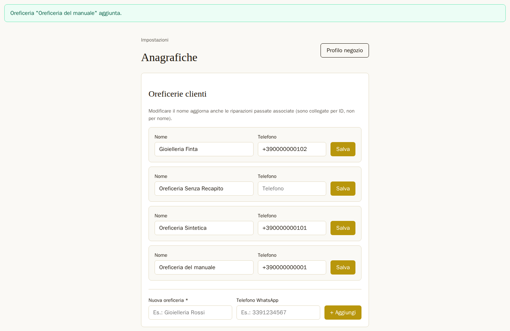
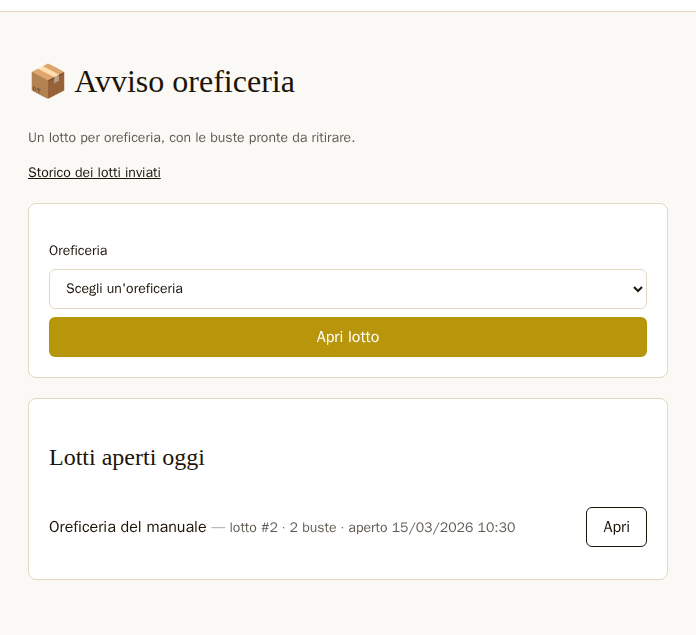
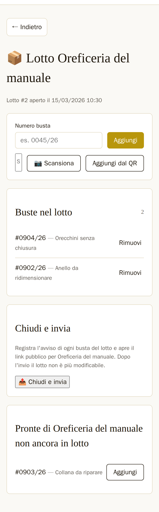
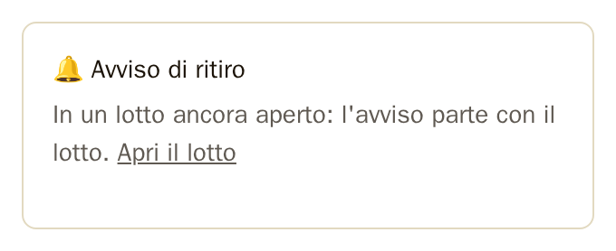
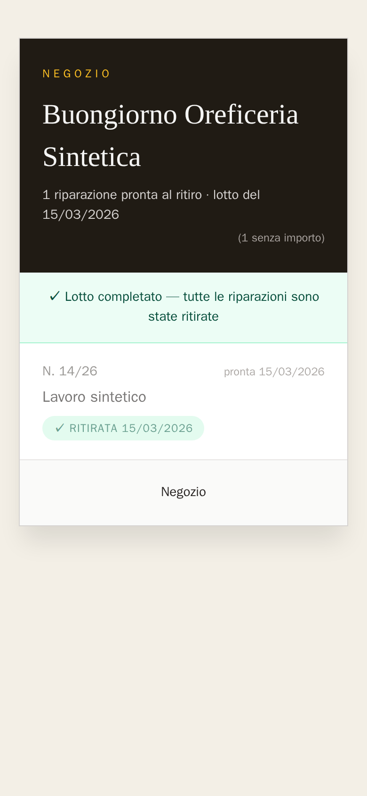
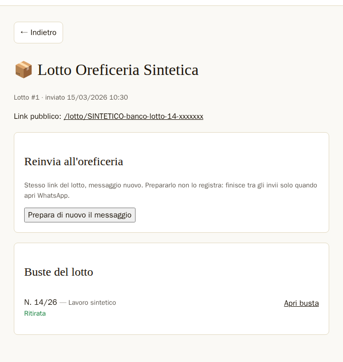

# Oreficerie

Il negozio lavora anche per altre oreficerie: le oreficerie gli portano oggetti da riparare, e il negozio
li ripara per loro. In GestRip una **oreficeria** è una voce dell'anagrafica con un nome e, se serve, un
numero WhatsApp. Le sue buste sono le **buste di un'oreficeria** (la scheda le chiama anche «busta conto
terzi»).

Questo capitolo spiega come si tiene l'elenco delle oreficerie, come si segna che una busta è di
un'oreficeria e, soprattutto, come si avvisa un'oreficeria che le sue riparazioni sono pronte: non busta per
busta, ma con un **lotto**, cioè un solo messaggio WhatsApp con un link che apre la pagina con tutte le sue
buste pronte.

Titolare e dipendente fanno tutto quello che c'è in questo capitolo. Il capitolo dice dove serve il
titolare: solo lui cambia i dati del negozio che compaiono in fondo alla pagina che vede l'oreficeria
(Impostazioni → «Negozio») e solo lui cambia i testi dei messaggi (Impostazioni → «Messaggi WhatsApp»).

Le schermate sono prese con dati inventati: nomi, numeri e telefoni non sono di clienti veri né di
oreficerie vere.

## Le oreficerie in anagrafica

Dal menu ☰ tocca «Anagrafiche». In cima alla pagina c'è il riquadro «Oreficerie clienti», sopra quello degli
artigiani. Titolare e dipendente lo usano allo stesso modo.

*Figura 9.1 — «Oreficerie clienti»: una riga per oreficeria, con nome, telefono e «Salva», e in fondo il modulo «Nuova oreficeria *».*

Ogni oreficeria ha una riga con il suo «Nome», il suo «Telefono» e il pulsante «Salva». Le righe sono in
ordine di nome. Se non c'è nessuna oreficeria, il riquadro dice «Nessuna oreficeria registrata.».

Per aggiungere un'oreficeria scrivi il nome in «Nuova oreficeria *» e tocca «+ Aggiungi». Il nome è
obbligatorio. Il «Telefono WhatsApp» si può lasciare vuoto. Quando l'oreficeria è stata aggiunta, in alto
compare «Oreficeria "…" aggiunta.» con il nome che hai scritto.

Se il nome è vuoto, la pagina dice «Il nome è obbligatorio.» e sotto il campo «Campo obbligatorio.»; non si
aggiunge niente.

Del telefono GestRip tiene solo le cifre e l'eventuale «+» iniziale: spazi, trattini e parentesi si tolgono.
Per esempio «+39 000 000 0001» diventa «+390000000001». Se nel telefono non resta nessuna cifra, l'oreficeria
si salva senza telefono.

Il nome di un'oreficeria non si può ripetere. Se ne scrivi uno già in elenco, la pagina dice «Esiste già
un'oreficeria con il nome "…".» e non salva. Quando aggiungi un'oreficeria contano anche le maiuscole:
«Rossi» e «ROSSI» sono due nomi diversi. Quando modifichi un'oreficeria che c'è già non contano: «rossi» è
lo stesso nome di «Rossi».

Il negozio stesso ha una riga sua, che non compare nell'elenco e non si può modificare. Il nome di quella riga
(il nome del negozio registrato in GestRip, che non è necessariamente quello di Impostazioni → «Negozio») non
si può dare a un'oreficeria, ma solo scritto con le stesse maiuscole: con maiuscole diverse il nome è
accettato.

Per cambiare il nome o il telefono di un'oreficeria scrivi nella sua riga e tocca «Salva»: compare
«Oreficeria aggiornata.». Se cambi il nome, cambia anche nelle riparazioni passate di quell'oreficeria: le
buste sono collegate all'oreficeria e non al suo nome.

Un'oreficeria non si può eliminare: la riga non ha il pulsante «Elimina», a differenza degli artigiani. Se
una è scritta male, correggi il nome. Se compare «Oreficeria non trovata o non modificabile.», la riga che
volevi modificare non c'è più (o è quella del negozio): ricarica la pagina.

## Una busta di un'oreficeria

In «Nuova riparazione» il menu «Oreficeria cliente» compare solo se in anagrafica c'è almeno un'oreficeria.
La prima voce del menu è «— Diretta» seguita dal nome del negozio: se la lasci scelta, la busta è una busta
diretta. Se scegli un'oreficeria, la busta è di quell'oreficeria. Lo stesso menu c'è nella modifica della
busta.

Nella scheda la voce «Oreficeria cliente» dice il nome dell'oreficeria, oppure «Diretta» e il nome del
negozio. Su una busta di un'oreficeria si scrive all'oreficeria e non al cliente finale: il «Telefono» della
scheda è quello dell'oreficeria, con sotto «Oreficeria» e il suo nome, mentre il «Telefono cliente finale» è
solo un'anagrafica e la scheda lo dice: «Solo anagrafica: su busta B2B si scrive all'oreficeria.». Nella
modifica della busta il telefono del cliente finale è spento, con la frase «Busta conto terzi: si scrive solo
all'oreficeria, il telefono del cliente finale non si modifica.». Anche le foto sono per l'oreficeria: sotto
ogni foto il pulsante del canale si chiama «Orefice» (capitolo 3).

## Avvisare l'oreficeria con un lotto

Quando le buste di un'oreficeria sono pronte, si può avvisarla busta per busta, con «📲 Avvisa oreficeria»
della scheda (capitolo 7, da scrivere), oppure tutte insieme con un **lotto**. Un lotto è un gruppo di buste pronte della
stessa oreficeria. Quando lo invii, GestRip registra l'avviso di ritiro di ogni busta del lotto e prepara un
solo messaggio WhatsApp per l'oreficeria, con il link della pagina del lotto.

Un lotto è **aperto** finché non lo invii: puoi aggiungere e togliere buste. Dopo l'invio il lotto è
**inviato** e non si cambia più.

### Aprire un lotto

Dal menu ☰ tocca «📦 Avvisi oreficeria». La pagina si chiama «📦 Avviso oreficeria».

1. Nel menu «Oreficeria» scegli l'oreficeria.
2. Tocca «Apri lotto».
3. Si apre la pagina del lotto, vuota se è nuovo.

Un'oreficeria ha **un solo lotto aperto al giorno**. Se tocchi «Apri lotto» per un'oreficeria che ha già un
lotto aperto oggi, si riapre quello e non se ne crea un altro. «Oggi» è il giorno del negozio, da
mezzanotte.

Se non scegli nessuna oreficeria, la pagina dice «Seleziona un'oreficeria.» e non apre niente. Se in
anagrafica non c'è nessuna oreficeria, la pagina dice «Nessuna oreficeria in anagrafica. Aggiungine una.» con
il link «Aggiungine una» che porta ad «Anagrafiche».

*Figura 9.2 — «Avviso oreficeria»: il menu per aprire un lotto e, sotto, «Lotti aperti oggi» con il lotto, quante buste ha, l'ora di apertura e «Apri».*

Sotto il menu, «Lotti aperti oggi» elenca i lotti di oggi non ancora inviati. Ogni riga dice l'oreficeria, il
numero del lotto, quante buste ha («2 buste») e quando è stato aperto, con il pulsante «Apri». Se non ce ne
sono, la pagina dice «Nessun lotto aperto oggi.».

Quando apri la pagina «Avviso oreficeria», GestRip cancella da solo i lotti rimasti aperti nei giorni prima
senza nessuna busta.

Un lotto rimasto aperto nei giorni prima **con** delle buste non compare più in «Lotti aperti oggi», e «Apri
lotto» per la stessa oreficeria ne apre uno nuovo. Le buste del lotto vecchio restano in quel lotto. Per
ritrovarlo apri la scheda di una delle sue buste: nel riquadro «🔔 Avviso di ritiro» c'è «In un lotto ancora
aperto: l'avviso parte con il lotto.» e il link «Apri il lotto». Da lì puoi inviarlo oppure togliere le buste
e metterle nel lotto di oggi.

In alto, sotto il titolo, il link «Storico dei lotti inviati» porta ai lotti già partiti (più sotto).

### Aggiungere le buste

La pagina del lotto ha in alto «📦 Lotto» e il nome dell'oreficeria, e sotto «Lotto #N aperto il» (N è il numero del lotto) con la
data e l'ora di apertura. «← Indietro» torna alla lista dei lotti.

*Figura 9.3 — Un lotto aperto con due buste: i campi per aggiungere, «Buste nel lotto» con «Rimuovi», «Chiudi e invia» e le buste pronte dell'oreficeria che non sono ancora nel lotto.*

Una busta si aggiunge in tre modi:

- scrivi il numero dell'etichetta in «Numero busta» (per esempio «0045/26» o «45») e tocca «Aggiungi»;
- leggi il QR dell'etichetta nel campo «Scansiona o inserisci il codice QR» e tocca «Aggiungi dal QR»: con
  il lettore a pistola tocca il campo e spara sull'etichetta, il lettore preme Invio da solo;
- scegli una busta dall'elenco «Pronte di … non ancora in lotto» e tocca «Aggiungi» accanto a lei.

Quando la busta entra, in alto compare «✓ Aggiunta busta #0045/26» e i campi si svuotano. «Buste nel lotto»
dice quante sono. L'elenco «Pronte di … non ancora in lotto» mostra le buste che si possono aggiungere, dalla
più recente in base alla data di «pronta».

In un lotto entra una busta solo se tutte queste cose sono vere:

- la busta è **pronta**;
- è dell'oreficeria del lotto (non di un'altra, non diretta);
- non è una scheda Compro Oro;
- non è nel cestino;
- non è già in un altro lotto;
- l'avviso di ritiro non è già stato mandato a mano.

Se una di queste non è vera, la busta non entra e GestRip dice perché. I messaggi sono questi:

- «Busta non pronta.»
- «Busta di altra oreficeria.»
- «Le schede compro oro non entrano in un lotto.»
- «Busta già avvisata singolarmente: azzera l'avviso dal dettaglio, poi riprova.» Una busta già avvisata a
  mano resta nell'elenco, con la scritta «Già avvisata singolarmente» e il pulsante «Apri busta» al posto di
  «Aggiungi». Per metterla nel lotto apri la sua scheda e tocca «Azzera l'avviso» (capitolo 7, da scrivere).
- «Busta già nel lotto #N: toglila da lì, poi riprova.» La busta è in un altro lotto ancora aperto, quello
  col numero N.
- «Busta già uscita col lotto #N: resta sua. Per riavvisare il cliente usa l'avviso singolo dal dettaglio.»
  La busta è già partita con un lotto inviato.
- «Busta già in questo lotto.» Non è un errore: la busta c'è già, non succede altro.
- «Riparazione non trovata.» Nessuna busta ha quel numero o quel QR, oppure la busta è nel cestino: una busta
  nel cestino non entra in un lotto.
- «Numero busta, QR o id richiesto.» Hai toccato «Aggiungi» con il campo vuoto.

Se il numero che scrivi vale per più buste che il lotto può prendere (per esempio la stessa etichetta di due
anni diversi), GestRip sceglie quella dell'anno in corso. Se ne restano ancora più d'una, non aggiunge niente
e dice «Più buste corrispondono a «0045»: scrivi il numero con l'anno o usa il QR.». Scrivi il numero con
l'anno («0045/26») per essere sicuro.

«Rimuovi», accanto a una busta del lotto, la toglie dal lotto e la rimette fra le buste pronte non ancora in
lotto. Compare «Busta #0045/26 rimossa dal lotto.». «Rimuovi» non chiede conferma.

Nella scheda di una busta che è in un lotto aperto, il riquadro «🔔 Avviso di ritiro» dice «In un lotto ancora
aperto: l'avviso parte con il lotto.» e ha il link «Apri il lotto», che porta alla pagina del lotto.

*Figura 9.4 — La scheda di una busta in un lotto aperto: l'avviso di ritiro non si manda da solo, parte con il lotto.*

Finché la busta è in un lotto aperto non si può avvisare da sola. Per avvisarla da sola toglila prima dal
lotto con «Rimuovi».

### Aggiungere le buste con la fotocamera

«📷 Scansiona», accanto ad «Aggiungi dal QR», apre la finestra della fotocamera (capitolo 6) in modo
continuo: la fotocamera resta accesa e ogni etichetta inquadrata entra subito nel lotto, senza altri tocchi.

Sotto il video una riga dice come è andata: «✓ Aggiunta busta #0045/26 · 3 nel lotto», dove 3 è il numero di
buste che il lotto ha adesso. Anche le righe di errore che seguono finiscono con « · N nel lotto». Alla
riuscita suona un bip acuto.

Se la busta non può entrare, la riga dice perché e suonano due bip gravi:

- «↻ Busta già in questo lotto» se la busta c'è già;
- «Riparazione non trovata. («…»)» con il codice letto, se nessuna busta ha quel codice;
- uno dei motivi dell'elenco sopra («Busta non pronta.», «Busta di altra oreficeria.» e gli altri).

Se il codice letto non è un'etichetta di GestRip, GestRip lo prova anche come numero di busta.

Se tieni la stessa etichetta ferma davanti alla fotocamera, GestRip non la rilegge ogni momento: per
rileggerla, toglila dall'inquadratura per due secondi e inquadrala di nuovo.

«Chiudi» chiude la finestra e torna al lotto con l'elenco aggiornato. Se durante la scansione c'è stato un
errore, la pagina mostra l'ultimo. Quello che stavi scrivendo nei campi resta.

I suoni funzionano come nel capitolo 6: partono solo dopo che hai toccato il 📷 almeno una volta, e
l'interruttore 🔊/🔇 del capitolo 6 vale anche qui.

### Chiudi e invia

Quando il lotto ha almeno una busta, sotto le buste compare il riquadro «Chiudi e invia». Dice: «Registra
l'avviso di ogni busta del lotto e apre il link pubblico per» il nome dell'oreficeria, e «Dopo l'invio il
lotto non è più modificabile.». Un lotto senza buste non ha il riquadro.

Se l'oreficeria non ha un numero WhatsApp in anagrafica, il riquadro lo dice prima dell'invio: «… non ha un
numero WhatsApp: dopo l'invio scegli tu il contatto. Salva il numero in Anagrafiche per aprire subito la sua
chat.». Il lotto parte lo stesso.

Per inviare tocca «📤 Chiudi e invia». GestRip chiede «Inviare il lotto? Ogni busta risulterà avvisata e il
lotto non sarà più modificabile.». Con «OK» il lotto parte, con «Annulla» non cambia niente.

L'invio è **tutto o niente**. Se parte, succede questo, tutto insieme:

- il lotto risulta inviato e non si cambia più;
- ogni busta del lotto risulta avvisata: la sua scheda dice «📲 Avvisato il …», come per un avviso mandato a
  mano;
- GestRip prepara il messaggio per l'oreficeria, con il link del lotto.

L'avviso di ogni busta usa il testo «Aggiornamento oreficeria», con il link del lotto al posto di «{link}»:
si legge nella scheda della busta, in «📨 Invii registrati» (capitolo 7, da scrivere).

Se qualcosa non va, non parte niente: il lotto resta aperto, nessuna busta risulta avvisata, e la pagina dice
perché.

Dopo l'invio la pagina dice «Lotto inviato: apri WhatsApp per mandarlo all'oreficeria.» e mostra il riquadro
«Lotto inviato» con:

- il testo pronto del messaggio;
- «Apri WhatsApp», che apre la chat dell'oreficeria con il testo già scritto (c'è solo se l'oreficeria ha un
  numero);
- «👥 Scegli contatto», che apre WhatsApp perché scegli tu a chi mandare il testo, per esempio a un collega
  dell'oreficeria (c'è sempre; se l'oreficeria non ha un numero, la pagina dice «Nessun numero WhatsApp per
  questa oreficeria: scegli tu il contatto.»);
- il «Link pubblico» del lotto.

**GestRip non manda niente da solo.** Il messaggio parte solo quando lo mandi tu da WhatsApp. Quando tocchi
«Apri WhatsApp» o «👥 Scegli contatto», WhatsApp si apre in una scheda nuova e GestRip torna alla lista delle
riparazioni.

Il titolare cambia il testo del messaggio in Impostazioni → «Messaggi WhatsApp» (capitolo 7, da scrivere), nel testo «Avviso lotto
pronte oreficeria». Quello di fabbrica è «Buongiorno {oref_nome}, ho {n_buste} riparazioni pronte da farvi
ritirare. Dettagli e foto: {link}», seguito dal nome del negozio. «{oref_nome}» diventa il nome
dell'oreficeria, «{n_buste}» il numero di buste e «{link}» il link del lotto.

Il testo pronto si vede una volta sola, nella risposta all'invio. Non ricaricare la pagina subito dopo l'invio:
il testo non si rivede e GestRip risponde «Lotto già inviato.». Se serve rimandare il messaggio, usa il
reinvio dallo storico (più sotto). Riaprendo il lotto la pagina dice «Questo lotto è partito il» con la data e
l'ora e il link pubblico, e il lotto porta il segno «· Non più modificabile».

Se l'invio non parte, la pagina dice il motivo. I messaggi che riguardano una busta, un testo o l'indirizzo
pubblico finiscono con «Niente è partito.»:

- «Busta #0045/26: non è più pronta. Niente è partito.» Il motivo può essere anche «non è più di questa
  oreficeria» o «è già stata avvisata». Sistema la busta, oppure toglila dal lotto con «Rimuovi», e riprova.
- «Lotto già inviato.» Qualcun altro ha inviato lo stesso lotto un attimo prima.
- «Lotto vuoto: aggiungi almeno una busta.» Tutte le buste sono state tolte.
- «Il testo «…» non è valido: …» Uno dei testi dei messaggi («Avviso lotto pronte oreficeria» o
  «Aggiornamento oreficeria») ha un errore, per esempio una parola tra graffe che non esiste. Il titolare lo
  corregge in Impostazioni → «Messaggi WhatsApp».
- «Lotto non inviato: manca «indirizzo_pubblico = …». Niente è partito.» Il messaggio ha «{link}», ma
  GestRip non conosce il suo indirizzo pubblico. È un'impostazione dell'installazione: va scritta da chi ha
  installato GestRip, nel file di configurazione, e GestRip va riavviato. Il manuale dell'installazione dice
  come.

## La pagina che vede l'oreficeria

Il link nel messaggio apre la **pagina pubblica del lotto**: la pagina che vede l'oreficeria, sul suo
telefono, senza fare nessun accesso.

*Figura 9.5 — La pagina del lotto come la vede l'oreficeria: il saluto, quante riparazioni, il giorno del lotto, lo stato, le buste e in fondo i dati del negozio.*

In alto ci sono il nome del negozio e il saluto «Buongiorno» con il nome dell'oreficeria. Sotto, quante
riparazioni ci sono («3 riparazioni pronte al ritiro», o «1 riparazione pronta al ritiro») e il giorno del
lotto («lotto del 19/11/2026»).

Per ogni busta la pagina mostra:

- il numero della busta, quello dell'etichetta («0045/26»), e il giorno in cui è diventata pronta;
- la prima foto della busta che l'oreficeria può vedere, se c'è;
- la descrizione, al massimo 100 caratteri (poi «…»);
- se è ancora da ritirare («✓ Pronta») o già ritirata («✓ Ritirata» con la data);
- il prezzo: il prezzo finale della busta e, se non c'è, quello del preventivo.

La pagina **non** mostra il nome né il telefono del cliente finale.

Il «Totale lotto» somma i prezzi delle buste, ma solo quelli scritti come un importo preciso («40»,
«40,50»). Un prezzo scritto come «400/500», o una busta senza prezzo, non si somma e si conta a parte: sotto
il totale compare «(1 senza importo)» se ce n'è una, «(2 senza importo esatto)» se sono due o più. Se nessuna
busta ha un importo preciso, il totale non compare.

Sotto il totale una riga dice a che punto è il lotto:

- «2 ancora da ritirare su 3» se ci sono buste non ancora ritirate;
- «✓ Lotto completato — tutte le riparazioni sono state ritirate» quando le ha ritirate tutte;
- «Il lotto non è ancora completato.» se tutte le buste che l'oreficeria vede sono ritirate ma il lotto ne ha
  altre (per esempio passate a un'altra oreficeria): il lotto si completa solo quando sono ritirate tutte;
- «Nessuna busta in questo lotto.» se il lotto non ha più buste.

Un lotto si chiude da solo quando l'ultima sua busta viene consegnata (anche con la firma di consegna,
capitolo 5). In più, se l'oreficeria apre la pagina e tutte le buste sono già ritirate, il lotto si chiude in
quel momento: serve per i lotti arrivati dal programma di prima, rimasti aperti.

In fondo alla pagina ci sono il nome, l'indirizzo e il telefono del negozio. Vengono da Impostazioni →
«Negozio», che può cambiare **solo il titolare**.

Le foto che l'oreficeria vede sono quelle con il pulsante «Orefice» acceso (✓) sotto la foto, nella scheda
della busta (capitolo 3). Se lo spegni (⛔), la foto sparisce subito dalla pagina del lotto.

Una busta che passa a un'altra oreficeria, torna diretta o finisce nel cestino sparisce dalla pagina del
lotto, con le sue foto.

Il link è la sola protezione della pagina: chi lo ha, la vede. Mandalo solo all'oreficeria. Il link funziona
solo dopo «📤 Chiudi e invia». Un link sbagliato, di un lotto non ancora inviato o spento durante
l'importazione dal programma di prima mostra «Lotto non disponibile». Se da uno stesso indirizzo arrivano 30
link sbagliati in un minuto, quell'indirizzo è bloccato per 15 minuti.

## Lo storico dei lotti

Il link «Storico dei lotti inviati» della pagina «Avviso oreficeria» apre «📦 Storico lotti»: i lotti già
partiti, dal più recente, al massimo gli ultimi 100. Un lotto inviato non si cancella: resta come memoria di
chi è stato avvisato e quando. Se non ce ne sono, la pagina dice «Nessun lotto inviato.».

Ogni riga dice l'oreficeria, il numero del lotto, quante buste ha («3 buste»), quando è partito e a che punto è: «2 da ritirare» finché mancano buste, «Completato il
…» quando l'oreficeria le ha ritirate tutte. «Apri» mostra il dettaglio.

*Figura 9.6 — Il dettaglio di un lotto inviato: quando è partito, il link pubblico, «Reinvia all'oreficeria» e le buste con «Ritirata» e «Apri busta».*

Il dettaglio dice quando il lotto è partito e, se è completo, quando si è completato. Poi c'è il «Link
pubblico» del lotto (lo stesso del messaggio), e le buste del lotto: quelle ritirate portano «Ritirata», e
«Apri busta» apre la scheda. Un lotto arrivato dal programma di prima può avere il link spento: allora la
pagina dice «Link storico non riattivato durante l'importazione.» e il lotto non si può reinviare.

### Reinviare il messaggio

Se l'oreficeria non ha ricevuto il messaggio, o l'ha perso, si può reinviare. Il riquadro «Reinvia
all'oreficeria» c'è solo per un lotto inviato, non ancora completato e con il link acceso. Reinviare **non**
cambia niente alle buste: i loro avvisi restano quelli di prima.

1. Tocca «Prepara di nuovo il messaggio». GestRip scrive di nuovo il testo, con lo stesso link, e dice
   «Messaggio pronto: apri WhatsApp per reinviarlo e registrarlo.». Il numero di buste nel testo è quello
   delle buste del lotto che l'oreficeria vede ancora sulla sua pagina, comprese quelle già ritirate; non
   contano quelle passate a un'altra oreficeria o finite nel cestino.
2. Tocca «↗ Apri WhatsApp» (la chat dell'oreficeria) oppure «👥 Scegli contatto» (scegli tu a chi mandarlo).
   Se l'oreficeria non ha un numero, c'è solo «👥 Scegli contatto», con l'invito a salvare il numero in
   Anagrafiche.

«Prepara di nuovo il messaggio» non registra niente. Il reinvio si registra solo quando tocchi uno dei due
pulsanti di WhatsApp; con quel tocco GestRip registra un invio verso l'oreficeria e apre WhatsApp. Un secondo
tocco sullo stesso messaggio riapre WhatsApp e non registra di nuovo.

Il messaggio preparato vale 30 minuti ed è legato al tuo accesso. Se passa più tempo, se GestRip si
riavvia, o se esci e rientri, il tocco dice «Prepara di nuovo il messaggio: niente è stato registrato.»:
basta preparare il messaggio un'altra volta.

Se tutte le buste del lotto sono state ritirate, la pagina dice «Tutte le buste del lotto sono state
ritirate.» e non prepara niente. Se nessuna busta del lotto è più dell'oreficeria, dice «Nessuna busta del
lotto è ancora di questa oreficeria: niente da reinviare.».

Un lotto che non c'è, o che non è ancora partito, riporta all'elenco dello storico con «Lotto non trovato
nello storico.».

## Senza JavaScript

Se il browser non esegue JavaScript (raro) le oreficerie, i lotti, lo storico e la pagina che vede
l'oreficeria funzionano lo stesso, ma:

- «📷 Scansiona» non fa niente: per leggere le etichette si usa il lettore a pistola nel campo del QR;
- «📤 Chiudi e invia» non chiede conferma: il lotto parte subito, perché la domanda è una finestra del
  browser. Tocca il pulsante solo quando sei sicuro;
- «Apri WhatsApp» e «👥 Scegli contatto» aprono WhatsApp in una scheda nuova e GestRip resta sulla pagina del
  lotto, invece di tornare alla lista;
- nel reinvio, il tocco su «↗ Apri WhatsApp» o «👥 Scegli contatto» registra il reinvio e apre WhatsApp.
