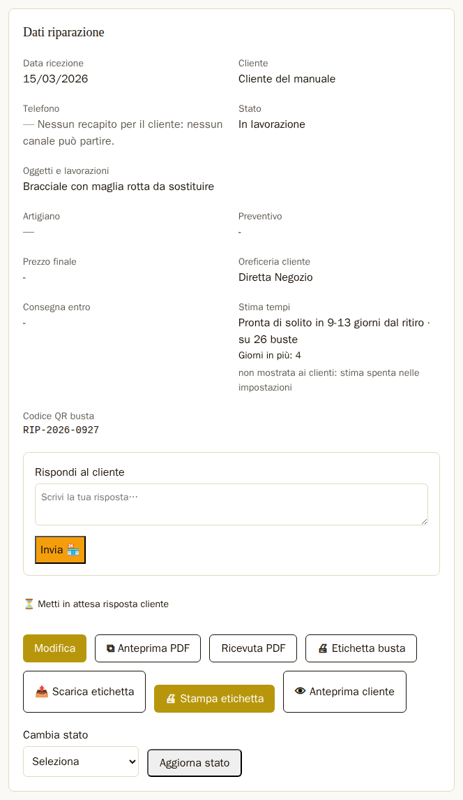
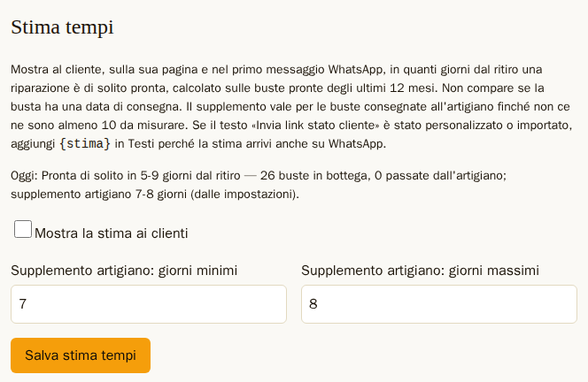
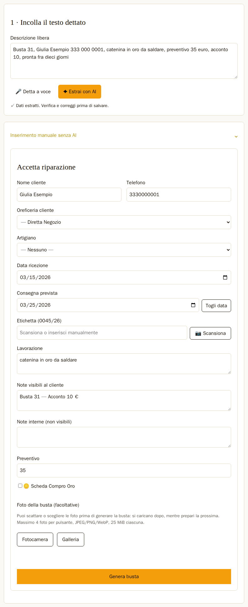
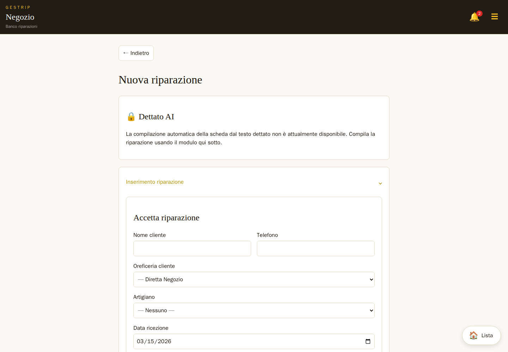
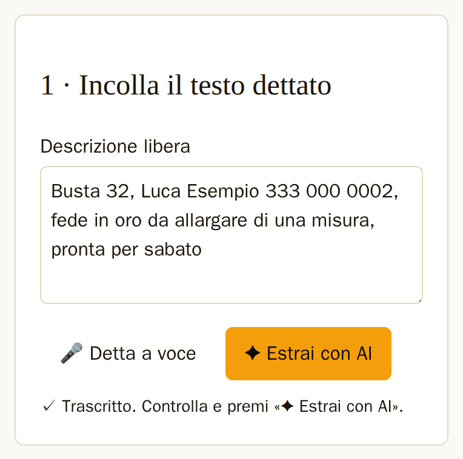
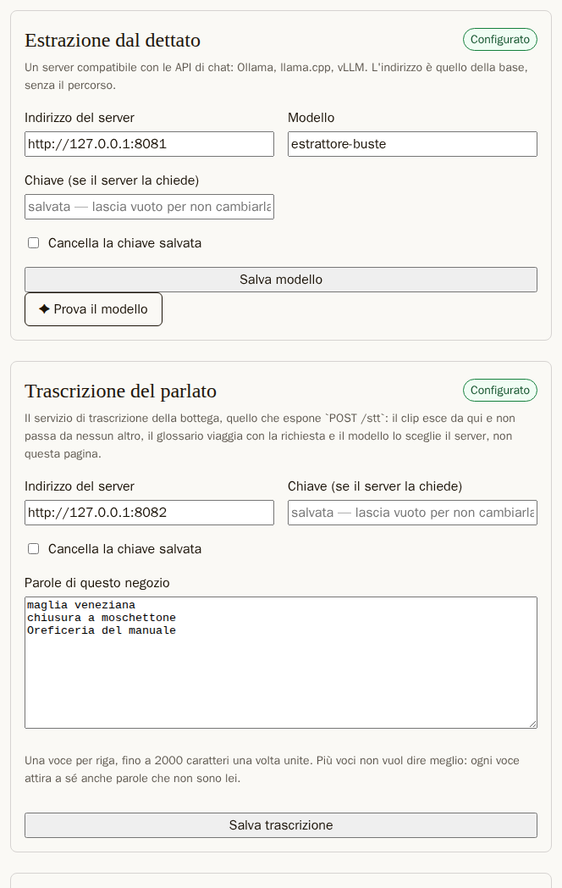
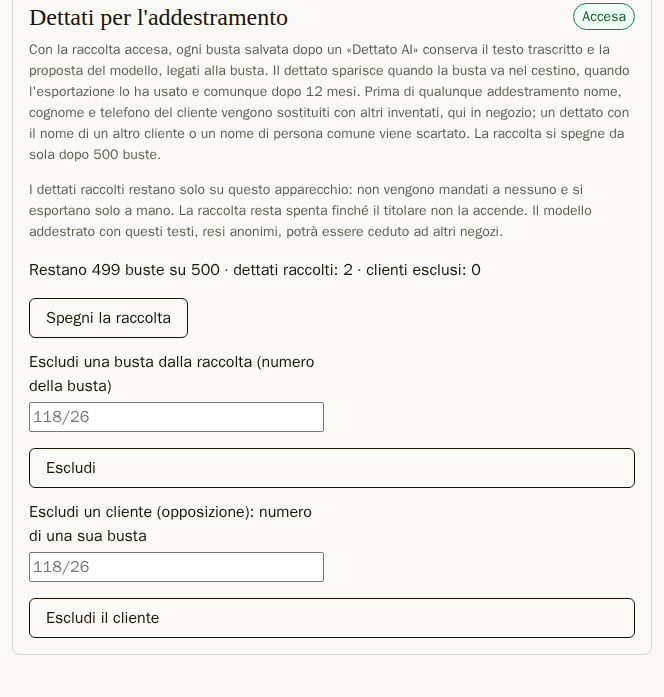
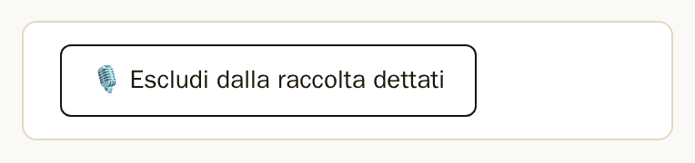

# Dettato AI e stima dei tempi

La **stima dei tempi** dice in quanti giorni dal ritiro una riparazione è di solito pronta, calcolata sulle
buste che nel negozio sono già state pronte. Il **Dettato AI** compila la busta nuova da una descrizione
libera: si scrive (o si detta a voce) il testo e il programma riempie i campi del modulo. Questo capitolo
spiega come si usano e cosa fare quando qualcosa non va.

La stima la vede sempre il negozio; il cliente la vede solo quando il titolare l'ha accesa nelle
impostazioni. Il Dettato AI funziona solo con il modello dell'**assistente** configurato: la sola trascrizione non
basta. Finché il modello non c'è, la pagina di accettazione non mostra il dettato e la busta si compila a mano.

**Solo il titolare** fa queste quattro cose: cambiare la stima in Impostazioni → «Negozio», configurare
l'assistente in Impostazioni → «Assistente», usare la sezione «Dettati per l'addestramento» e premere
«🎙️ Escludi dalla raccolta dettati» nella scheda. Tutto il resto di questo capitolo lo fanno il titolare e
il dipendente.

Le schermate sono prese con dati inventati: nomi, numeri e telefoni non sono di clienti veri né di oreficerie
vere.

## La stima dei tempi

La stima dei tempi è un intervallo di giorni, scritto «Pronta di solito in N-M giorni dal ritiro»: dal giorno
in cui il negozio ritira l'oggetto al giorno in cui la busta è pronta. Il conto viene dalle buste di
riparazione pronte negli ultimi 365 giorni (la pagina delle impostazioni le chiama «gli ultimi 12 mesi»).
L'intervallo viene solo dalle buste rimaste in bottega; quelle passate dall'artigiano servono per il
**supplemento artigiano**, come dice «Come si calcola» sotto.

Una busta che ha impiegato più di 90 giorni, o meno di zero, non entra nel conto.

### Nella scheda della busta

«Stima tempi» compare nella scheda solo di una riparazione aperta: «In lavorazione», «Preventivo» o «In
attesa materiali». Una busta «Pronta», «Consegnata», «Annullata» o una scheda Compro Oro non hanno la riga.
Leggere la scheda non cambia niente.

Con almeno 20 buste pronte rimaste in bottega negli ultimi 365 giorni la scheda dice «Pronta di solito in
N-M giorni dal ritiro · su X buste». X conta anche le buste passate dall'artigiano; il numero che serve per
la stima sono solo quelle rimaste in bottega.

*Figura 10.1 — «Stima tempi» nella scheda: l'intervallo con «su X buste», sotto «Giorni in più: 4» e la riga «non mostrata ai clienti: stima spenta nelle impostazioni».*

Con meno buste la scheda dice «Dati insufficienti: servono almeno 20 buste pronte (ora N)», dove N è quante
buste pronte in bottega ci sono adesso.

Se la busta ha dei «Giorni in più» maggiori di zero, la scheda scrive sotto «Giorni in più: N». Questa riga
c'è anche quando non c'è un intervallo, e l'intervallo c'è anche senza «Giorni in più».

Il negozio vede la stima sempre, anche con l'interruttore spento o con una data di consegna scritta. Quando il
cliente non la vede, la scheda lo dice sotto l'intervallo: «non mostrata ai clienti: stima spenta nelle
impostazioni», oppure «non mostrata ai clienti: c'è una data di consegna». La frase del perché compare solo
accanto a un intervallo.

### Sulla pagina del cliente

La pagina che vede il cliente mostra lo stesso intervallo sotto «Tempo indicativo».

La stima non compare sulla pagina del cliente in quattro casi: l'interruttore del titolare è spento; la busta
ha una data di consegna scritta dal negozio; la busta non è una riparazione aperta; i dati non bastano, cioè in
bottega ci sono meno di 20 buste pronte negli ultimi 365 giorni.

La promessa del negozio vince sulla media: con una data di consegna il cliente legge quella data, non
l'intervallo.

Se il testo «Invia link stato cliente» è stato personalizzato o è arrivato dal programma di prima, aggiungi
«{stima}» nei Testi di Impostazioni → «Messaggi WhatsApp» (solo il titolare), altrimenti la stima non arriva
nel primo messaggio WhatsApp (capitolo 7, da scrivere).

### Come si calcola

Il conto prende le buste di riparazione, fuori dal cestino, diventate pronte negli ultimi 365 giorni con una
durata da 0 a 90 giorni, e le divide in due gruppi: quelle rimaste in bottega e quelle passate dall'artigiano.

L'intervallo di base viene dalle buste rimaste in bottega: parte dal 25° percentile delle durate e arriva al
75°, arrotondato verso il basso e verso l'alto, e sempre largo almeno un giorno. Con meno di 20 buste in
bottega non c'è intervallo.

Una busta passata dall'artigiano riceve in più il **supplemento artigiano**, aggiunto a entrambi i capi
dell'intervallo. Quando in bottega c'è un intervallo e dall'artigiano sono passate almeno 10 buste, il
supplemento si misura sui dati di quelle buste; altrimenti sono i due numeri scritti nelle impostazioni.

I «Giorni in più» della busta si aggiungono a entrambi i capi dell'intervallo, anche per una busta non
passata dall'artigiano.

### I «Giorni in più» di una busta

Nella modifica della busta, in scheda, il campo si chiama «Giorni in più (stima tempi)» e accetta un numero da
0 a 90. Fuori da quel range è il browser ad avvisare, con il suo messaggio, e la modifica non viene inviata.

Il messaggio «Giorni in più: da 0 a 90.» della pagina è il rifiuto del programma per un valore fuori range che
arriva comunque: di norma non lo si vede, perché il browser avvisa prima.

## La stima nelle impostazioni (solo il titolare)

Dal menu ☰ tocca «Impostazioni» e la scheda «Negozio»: la sezione «Stima tempi» sta sotto il profilo del
negozio. È solo del titolare; un dipendente che ci va torna alla lista con «Operazione riservata al
titolare.»

La stima parte spenta. Il titolare l'accende con la casella «Mostra la stima ai clienti» e preme «Salva stima
tempi». Un import dal programma di prima non la accende: dopo l'import la stima è spenta, finché il titolare non
la accende.

*Figura 10.2 — «Stima tempi» nelle impostazioni del negozio: la casella «Mostra la stima ai clienti», i due campi del supplemento artigiano, la riga «Oggi» con i conti e «Salva stima tempi».*

I due campi «Supplemento artigiano: giorni minimi» e «Supplemento artigiano: giorni massimi» accettano numeri
da 0 a 90 e partono da 7 e 8. Fuori da quel range è il browser ad avvisare, con il suo messaggio, e il modulo
non si salva: nelle impostazioni non cambia niente.

Un «giorni massimi» scritto sotto il «giorni minimi» viene portato al minimo: la stima non ha mai un massimo
più basso del minimo.

La riga «Oggi» dice la stima di oggi e i conti dietro di lei, per esempio «Oggi: Pronta di solito in 6-11
giorni dal ritiro — 34 buste in bottega, 12 passate dall'artigiano; supplemento artigiano 2-4 giorni
(misurato sui dati).». Senza abbastanza buste la riga comincia con «Dati insufficienti: servono almeno 20
buste pronte (ora N)» e i conti restano; il supplemento, in quel caso, è quello delle impostazioni e la riga
dice «(dalle impostazioni)».

Dopo il salvataggio compare «Stima tempi salvata.»; se hai acceso la stima, le schede smettono di dire «non
mostrata ai clienti: stima spenta nelle impostazioni». Con la casella spenta quella riga resta.

Se il salvataggio non riesce la pagina dice «Stima tempi non salvata: riprova.» e le impostazioni restano come
erano.

## Il Dettato AI nella nuova busta

Con il modello configurato in Impostazioni → «Assistente», «Nuova riparazione» si apre con il riquadro
«1 · Incolla il testo dettato»: la casella «Descrizione libera» e i pulsanti «🎤 Detta a voce» (compare solo
con la trascrizione configurata) e «✦ Estrai con AI». Il modulo sotto, «Inserimento manuale senza AI», resta
chiuso finché non serve e si apre da solo quando i dati sono stati estratti.

*Figura 10.3 — «1 · Incolla il testo dettato» con un dettato inventato, i pulsanti «🎤 Detta a voce» e «✦ Estrai con AI», il messaggio «✓ Dati estratti. Verifica e correggi prima di salvare.» e il modulo «Inserimento manuale senza AI» aperto con i campi compilati.*

Si scrive o si incolla la descrizione libera nella casella e si preme «✦ Estrai con AI». Il dettato deve essere
almeno 10 caratteri e al massimo 5000, contati sul testo senza gli spazi ai bordi.

L'attesa del modello è al massimo 90 secondi in tutto, compreso il nuovo tentativo che il programma fa da solo
quando il primo non ha risposto.

«✦ Estrai con AI» non salva niente. La busta la crea solo «Genera busta», o «Genera busta senza QR» se non
c'è un'etichetta: salva quello che vedi nella pagina, dopo le correzioni che hai fatto.

Con l'estrazione riuscita sotto la casella compare «✓ Dati estratti. Verifica e correggi prima di salvare.».
Se il negozio ha riconosciuto il cliente, compare la correzione: «✓ Nome cliente corretto da «X» a «Y».
Verifica i dati prima di salvare.».

### Cosa viene compilato

Dall'estrazione vengono riempiti questi campi del modulo: «Nome cliente», «Telefono», «Oreficeria cliente»,
«Data ricezione» (sempre la data di oggi), «Consegna prevista», «Lavorazione», «Note visibili al cliente»,
«Preventivo» e la casella «🪙 Scheda Compro Oro».

«Artigiano», «Note interne (non visibili)» ed «Etichetta (0045/26)» tornano vuoti, come in un modulo nuovo,
anche se li avevi già scritti: una nuova estrazione li cancella. Si scrivono a mano dopo.

Le note visibili al cliente sono scritte in un ordine fisso, separate da « — »: prima «Busta N», poi
«Acconto N €», poi le altre parole che il modello ha messo nelle note, per esempio
«Busta 31 — Acconto 20 € — pietra da ridimensionare».

La lavorazione non finisce nelle note: va nel campo «Lavorazione».

La casella «🪙 Scheda Compro Oro» si accende solo se nel dettato hai scritto «oro vecchio» o «scheda compro
oro». Un preventivo scritto nel dettato resta nel campo «Preventivo», che accetta anche una forchetta come
«400/500».

### Il nome del cliente e l'oreficeria

Il nome del cliente viene dal dettato, e il programma lo corregge dall'anagrafica solo nei due casi certi.

Primo caso, il telefono: se nel dettato c'è un telefono di almeno 7 cifre (i prefissi «0039» e «39» non
contano) e in anagrafica c'è un solo cliente con quel numero, il nome è il suo.

Secondo caso, il nome: se in anagrafica c'è un solo cliente con lo stesso nome, scritto con accenti, spazi,
apostrofi o maiuscole diverse, il nome è il suo. Vale anche quando il telefono c'è ma non porta a un solo
cliente.

Fuori da quei due casi il nome resta quello scritto dal modello e lo controlla chi accetta la busta: il
programma non approssima mai, perché un cliente riconosciuto male finirebbe sulla busta di un altro.

Se il telefono non è stato dettato e in anagrafica ci sono più clienti con lo stesso nome, il «Telefono»
resta vuoto e lo sceglie chi accetta la busta. Se tutti quei clienti hanno lo stesso numero, si propone
quello.

Un nome che è il nome del negozio o di un'oreficeria non diventa il nome del cliente.

L'«Oreficeria cliente» si segnala solo quando l'oreficeria che il modello ha estratto corrisponde a una delle
oreficerie dell'anagrafica: il nome estratto contiene il nome dell'oreficeria, o ne è contenuto. Non viene dal
nome del cliente. Senza quella corrispondenza il menu resta su «— Diretta» (capitolo 9).

### La data di consegna

«Consegna prevista» si riempie solo se il dettato contiene una frase di consegna riconosciuta, contata da
oggi. Le frasi riconosciute, nell'ordine in cui il programma le cerca:

- una data con il mese: «il 5 novembre», «15 dicembre 2026»; una data senza l'anno già passata si intende
  dell'anno dopo;
- «dopodomani» (2 giorni), «domani» e «domattina» (1 giorno), «oggi» e «stasera» (oggi);
- «Natale» (il 24 dicembre, l'anno dopo se è già passato);
- «fra/tra N giorni», «N settimane», «N mesi» con cifre o parole: «un», «due», «tre», «quattro», «cinque»,
  «sei», «sette», «otto», «nove», «dieci», «undici», «dodici», «quindici», «venti», «trenta»; «e mezzo»
  aggiunge 3 giorni alle settimane e 15 giorni ai mesi;
- «fine settimana» (il sabato; con «prossima» il sabato della settimana successiva);
- «fine mese» (l'ultimo giorno di questo mese);
- un giorno della settimana, con o senza numero: «venerdì prossimo», «lunedì 2»; detto nel giorno stesso
  significa sette giorni dopo;
- «il N», per esempio «entro il 15»: il giorno N di questo mese, o del mese prossimo se è già passato.

Se la frase non è riconosciuta, «Consegna prevista» resta vuoto e la data la scrive chi accetta la busta.

Una data da incidere non è una consegna: «fede da incidere con la data 12 dicembre 2026» non riempie
«Consegna prevista».

### Quando il dettato non va

Un rifiuto scrive il messaggio sotto la casella, in rosso, e non cambia quello che già c'è nel modulo:

- «Nessun modello è configurato: non è stato chiesto niente a nessuno.»
- «⚠ Testo troppo corto: servono almeno 10 caratteri.»
- «⚠ Testo troppo lungo: al massimo 5000 caratteri.»
- «⚠ Il modello non ha risposto con una scheda leggibile, riprova.»
- «⚠ AI temporaneamente non disponibile, riprova fra qualche minuto.»

Senza il modello configurato la pagina mostra il riquadro «🔒 Dettato AI» con la frase «La compilazione
automatica della scheda dal testo dettato non è attualmente disponibile. Compila la riparazione usando il
modulo qui sotto.» e il modulo «Inserimento riparazione», come prima.

*Figura 10.4 — La pagina di accettazione con l'estrazione non configurata: «🔒 Dettato AI», la frase che invita a compilare a mano e il modulo «Inserimento riparazione».*

## Detta a voce

Con la trascrizione configurata in Impostazioni → «Assistente», nel riquadro «Trascrizione del parlato», il
riquadro del dettato ha il pulsante «🎤 Detta a voce» accanto a «✦ Estrai con AI».

Il primo tocco comincia la registrazione e il pulsante diventa «🔴 Sto ascoltando… (tocca per fermare)»; il
secondo tocco la ferma e manda la voce al servizio di trascrizione, con il messaggio «⏳ Trascrivo…».

Il testo trascritto si aggiunge in fondo alla casella «Descrizione libera», separato da uno spazio: si può
dettare in più riprese e scrivere il resto a mano. Poi si preme «✦ Estrai con AI».

Con la trascrizione riuscita il messaggio è «✓ Trascritto. Controlla e premi «✦ Estrai con AI».».

*Figura 10.5 — «Detta a voce» sul telefono: la casella con il testo trascritto in fondo e il messaggio «✓ Trascritto. Controlla e premi «✦ Estrai con AI».».*

La prima volta il browser chiede il permesso di usare il microfono.

Serve un indirizzo sicuro (https): con http il microfono non si usa e il messaggio è «⚠ Microfono non
disponibile: contesto non sicuro (HTTP o certificato non valido), il browser non espone il microfono.»

Un dispositivo senza microfono dice «⚠ Microfono non disponibile su questo dispositivo o browser.»; un permesso
negato dice «⚠ Microfono negato: … — scrivi a mano.» con il motivo del browser.

Un tocco di meno di 0,6 secondi non manda niente: «⚠ Troppo breve, riprova.»

Una registrazione troppo corta dice «⚠ Registrazione troppo breve.»

Una registrazione lunga si ferma da sola a 25 MiB, poco più di 13 minuti di parlato. L'attesa del servizio di
trascrizione è al massimo 35 secondi.

Gli altri messaggi del dettato a voce: «Nessuna trascrizione è configurata: scrivi a mano e premi Estrai.»;
«⚠ Questo browser ha registrato in un formato che non so inoltrare.»; «⚠ Trascrizione non disponibile,
scrivi a mano e premi Estrai.»; «🔇 Non ho sentito nulla, riprova.» (il servizio ha risposto senza trovare
voce).

GestRip non conserva l'audio: non resta sul computer né nel browser, e non resta sul server di GestRip.

Il testo trascritto non finisce nei log del programma né nel registro delle operazioni: lì non vanno mai il
testo, le «Parole di questo negozio» né la chiave.

Il dettato resta nella casella «Descrizione libera» della busta, come il testo scritto a mano. Una copia sua per
l'addestramento, con la proposta del modello, viene conservata solo se la raccolta dei dettati è accesa (sezione
«La raccolta dei dettati» di questo capitolo).

La clip va solo al servizio scritto nelle impostazioni, insieme alle «Parole di questo negozio»: quanto ne
conserva quel servizio non è in mano a GestRip.

## La configurazione dell'assistente (solo il titolare)

Dal menu ☰ tocca «Impostazioni» e la scheda «Assistente»: la pagina si chiama «Assistente e dettatura». È solo
del titolare; un dipendente che ci va torna alla lista con «Operazione riservata al titolare.».

L'installazione parla solo con i servizi scritti in questa pagina: nessun servizio centrale, nessuna quota,
nessun invio a fornitori esterni se non ne scrivi uno. La configurazione la prepara chi installa il
programma; qui si cambia solo quando si deve puntare a un server diverso.

*Figura 10.6 — «Assistente e dettatura»: i riquadri «Estrazione dal dettato» e «Trascrizione del parlato» con le spie «Configurato», i campi e i pulsanti «Salva modello», «✦ Prova il modello» e «Salva trascrizione».*

Il riquadro «Estrazione dal dettato» ha una spia «Configurato» o «Non configurato», i campi «Indirizzo del
server», «Modello» e «Chiave (se il server la chiede)», la casella «Cancella la chiave salvata» e i pulsanti
«Salva modello» e «✦ Prova il modello».

Il riquadro «Trascrizione del parlato» ha la sua spia, i campi «Indirizzo del server» e «Chiave (se il server
la chiede)», il campo «Parole di questo negozio» (una voce per riga, per esempio marche, cognomi e fornitori),
la casella «Cancella la chiave salvata» e il pulsante «Salva trascrizione».

L'«Indirizzo del server» comincia con «http://» o «https://» e al massimo 255 caratteri; il «Modello» al
massimo 120; la chiave al massimo 255.

Le «Parole di questo negozio» si scrivono una per riga, o separate da virgola, e una volta unite non possono
superare 2000 caratteri.

Gli errori sotto i campi sono: «non può essere vuoto», «deve cominciare con http:// oppure https://»,
«manca l'indirizzo del server», «una chiave non viaggia in chiaro verso un host remoto», «Troppo lungo
(massimo N caratteri).» e, per le parole del negozio troppo lunghe, «N carattere di troppo sul limite di
2000» o «N caratteri di troppo sul limite di 2000».

Una chiave si può usare con «http://» solo se il servizio sta sulla stessa macchina («127.0.0.1»,
«localhost»); verso un'altra macchina serve «https://».

La chiave non si rivede mai: la casella resta vuota con il segno «salvata — lascia vuoto per non cambiarla».
Lasciarla vuota conserva la chiave salvata; «Cancella la chiave salvata» la toglie.

Ogni salvataggio dice «Impostazione salvata.» e registra solo i nomi dei campi cambiati, mai i valori.

«✦ Prova il modello» manda una frase fissa senza clienti, «Busta 1, anello in oro da stringere di una
misura, preventivo 40 euro.», e mostra l'inizio della descrizione che il modello ha capito: «Il modello ha
risposto: «…».», con i primi 80 caratteri. Se il modello non ha risposto, la pagina dice «Il modello non è
configurato: non è stato chiesto niente.», «Il modello ha rifiutato: …» con un codice tecnico interno, oppure
«Il modello ha risposto qualcosa che non è un oggetto JSON.».

## La raccolta dei dettati (solo il titolare)

In «Assistente e dettatura» c'è la sezione «Dettati per l'addestramento», con la spia «Accesa» o «Spenta». È
solo del titolare, e mostra solo numeri: «Restano N buste su 500 · dettati raccolti: N · clienti esclusi: N».
Mai un dettato.

La **raccolta dei dettati** è spenta di default e resta spenta finché il titolare non l'accende. Dopo un
import dal programma di prima è spenta, e le buste rimaste del lotto restano come erano.

Con la raccolta accesa, ogni busta salvata dopo un «✦ Estrai con AI» conserva sull'apparecchio il testo
dettato e la proposta del modello, legati alla busta; le buste di un cliente escluso non si raccolgono (sotto).
Le buste compilate a mano non vengono raccolte. Se
prima di salvare si rifà l'estrazione, vale l'ultima.

Un **lotto della raccolta** è di 500 buste. La prima accensione ne apre uno; spegnere e riaccendere non lo
ricarica. A lotto finito la raccolta si spegne da sola.

*Figura 10.7 — «Dettati per l'addestramento» accesa: la spia «Accesa», la riga dei numeri, «Spegni la raccolta» e i due moduli «Escludi una busta dalla raccolta (numero della busta)» e «Escludi un cliente (opposizione): numero di una sua busta».*

Con la raccolta spenta e il lotto non finito si vede «Accendi la raccolta», che l'accende senza chiedere
conferma.

Con la raccolta accesa si vede «Spegni la raccolta», che spegne senza chiedere conferma.

A lotto finito si vede «Budget esaurito: la raccolta è finita.» con il pulsante «Avvia un nuovo lotto di 500
buste», che chiede conferma con «Avviare un nuovo lotto di 500 buste e riaccendere la raccolta?» e dà «Nuovo
lotto avviato: la raccolta è accesa.»

Il campo «Escludi una busta dalla raccolta (numero della busta)» con il pulsante «Escludi» cancella il dettato
di quella busta e la busta resta.

Si scrive il numero che si vede sull'etichetta, per esempio «0045/26», «0045» o «45». Gli esiti sono «Busta
0045/26 esclusa: il suo dettato è stato cancellato.», «Nessuna busta con questo numero.» e «La busta 0045/26
non ha un dettato raccolto.»

Se più buste hanno quel numero contano tutte, qualunque sia il loro stato, anche consegnate o nel cestino: niente
si cancella e la pagina dice «Più buste corrispondono a «45»: scrivi il numero con l'anno o usa il QR.» L'anno in
corso non viene scelto da solo.

Il campo «Escludi un cliente (opposizione): numero di una sua busta» con il pulsante «Escludi il cliente»
chiede conferma con «Cancellare i dettati di tutte le buste di questo cliente ed escludere le sue buste
future?» e dà «Cliente della busta 0045/26 escluso: cancellati N dettati; le sue buste future non saranno
raccolte.». Un cliente escluso non consuma il lotto.

Nella scheda di una busta il titolare trova il pulsante «🎙️ Escludi dalla raccolta dettati», ma solo se la
raccolta è stata accesa almeno una volta e il cliente non è già escluso; il dipendente non vede né il pulsante
né la riga. Il pulsante chiede conferma con «Escludere questo cliente dalla raccolta dei dettati? I dettati di
tutte le sue buste vengono cancellati e le sue buste future non saranno raccolte.» e poi la scheda di ogni
busta di quel cliente dice «🎙️ Cliente escluso dalla raccolta dettati (opposizione).» senza più il pulsante.

*Figura 10.8 — In fondo alla scheda, il pulsante «🎙️ Escludi dalla raccolta dettati», che si vede solo con la raccolta avviata almeno una volta.*

Dalla scheda non serve scrivere un numero: funziona anche per una busta che la pagina dell'assistente non
saprebbe scegliere. Gli esiti della scheda sono «Cliente escluso dalla raccolta dettati: cancellati N dettati;
le sue buste future non saranno raccolte.» e, se il tocco non riesce, «Esclusione non riuscita.». Una busta
nel cestino risponde «Riparazione non trovata.»

Se la raccolta ha un problema (per esempio il database non risponde) la busta si salva lo stesso: il dettato
non viene raccolto e niente si perde.

Una volta al giorno, da solo, il programma cancella i dettati raccolti da più di 12 mesi. Le buste restano.
Se l'ora del sistema sembra andata avanti, o il programma è appena stato importato e non c'è ancora un backup
verificato, la cancellazione aspetta il giorno dopo, senza avvisi.

## Esportare i dettati

L'esportazione mette in un file i dettati raccolti, per addestrare il modello che compila le buste. La fa chi
gestisce l'installazione, a mano, sul computer dove gira GestRip: il comando, le sue opzioni e i messaggi che
escono a schermo sono nel capitolo 12 Amministrazione.

Il file è leggibile solo da chi lo ha creato: gli altri utenti del computer non possono aprirlo.

Dentro, una riga per dettato: il giorno del dettato e il giorno della settimana, il testo dettato, la risposta
giusta (la busta com'è adesso, con le correzioni fatte dopo il dettato), la proposta del modello, il nome del
modello che ha risposto e i campi che il negozio ha corretto rispetto alla proposta, compreso se il nome è
stato corretto a mano o dall'anagrafica. Il numero della busta non compare mai.

Nome, cognome e telefono del cliente sono sostituiti da **pseudonimi** inventati, ovunque compaiano nel testo.
Le date, gli oggetti, i lavori, le incisioni, le oreficerie e i numeri di busta dettati restano. I valori
inventati sono diversi a ogni esportazione: la chiave di ciascuna è nuova e non viene salvata.

Una riga si scarta quando il nome o il telefono del cliente non si possono sostituire con certezza, quando nel
dettato compare una parola del nome di un altro cliente, quando il cliente si è opposto e quando la busta è nel
cestino.

A schermo escono solo numeri: quanti dettati c'erano, quanti esportati, quanti scartati e quanti cancellati, con
i numeri di ogni motivo di scarto. Mai un dettato, mai un nome, mai un esempio.

Dopo un'esportazione riuscita i dettati letti si cancellano dall'apparecchio, anche quelli scartati; i dettati
arrivati nel frattempo restano.

Se qualcosa va storto non si cancella niente e il file scritto a metà viene tolto. Nel caso raro in cui la
cancellazione ha dato errore e le righe non sono più tutte nel database, il file resta e chi l'ha lanciato lo
vede scritto.

## Senza JavaScript

Se il browser non esegue JavaScript (raro) il dettato scritto, la stima, la pagina dell'assistente e la
raccolta funzionano lo stesso, ma:

- «🎤 Detta a voce» non fa niente: la voce si scrive a mano nella casella;
- senza JavaScript il riquadro del dettato manda solo il testo dettato, e un rifiuto ridisegna la pagina con
  il modulo nuovo: quello che avevi già scritto nel modulo si perde;
- «Inserimento manuale senza AI» si apre e si chiude toccando il suo titolo; dopo un'estrazione riuscita il
  programma lo disegna già aperto, come con JavaScript;
- «🎙️ Escludi dalla raccolta dettati» della scheda non chiede conferma: il tocco esegue subito, perché la
  domanda è una finestra del browser;
- in «Assistente e dettatura», «Avvia un nuovo lotto di 500 buste» e «Escludi il cliente» chiedono la conferma
  nella pagina stessa, con «Sì» e «Annulla», e niente viene scritto finché non si preme «Sì».
