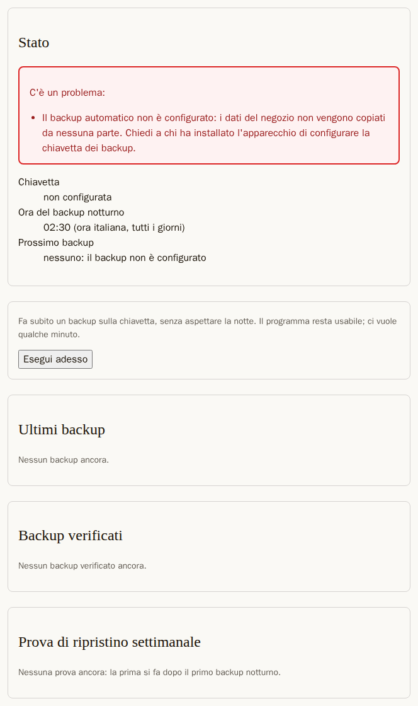
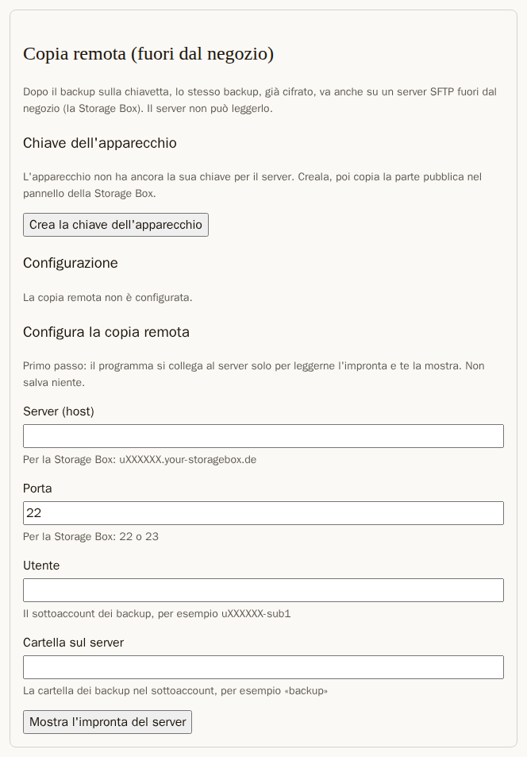
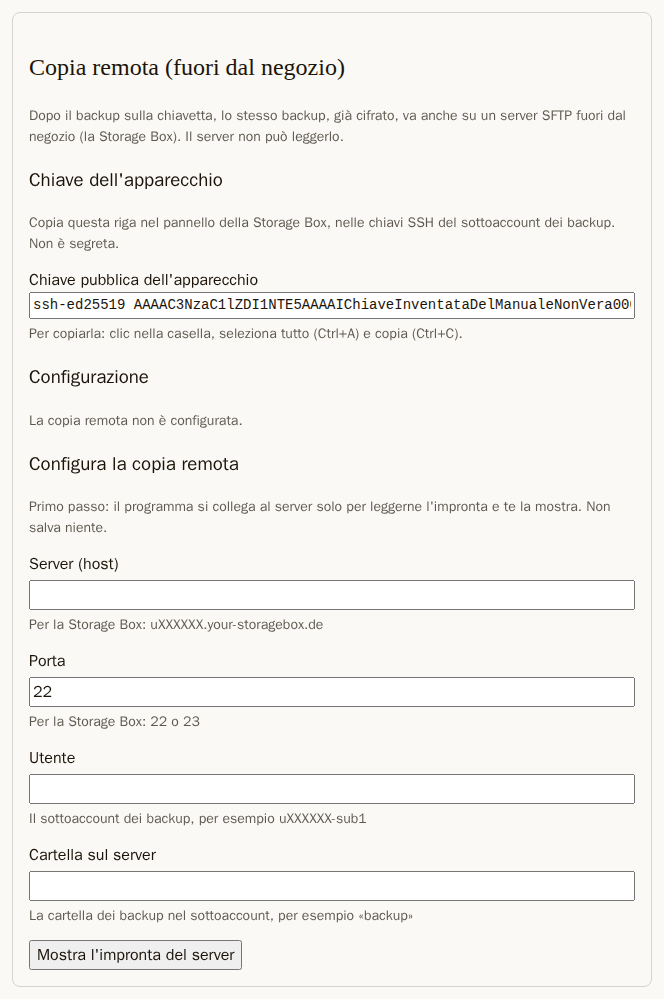

# Backup e ripristino

Il **backup** è una copia di tutti i dati del negozio: buste, clienti, foto, documenti e impostazioni. Serve
quando l'apparecchio si rompe, si perde o viene rubato: con il backup e la chiave dei backup i dati tornano su
un apparecchio nuovo. Questo capitolo spiega cosa fa il programma da solo ogni notte, cosa controlla il
titolare, cosa fare quando qualcosa non va e come si ripristinano i dati, passo passo.

**Solo il titolare** vede la pagina Impostazioni → «Backup», il riquadro rosso dei backup e la pagina della
conferma del ripristino. I comandi scritti nei riquadri grigi (per esempio `gestrip backup`) si lanciano dalla
**console** dell'apparecchio (la finestra dove si scrivono i comandi): li lancia chi gestisce l'installazione, con l'utente del programma (gestrip), mai come
root. Il personale non deve fare niente: il backup gira mentre il negozio lavora.

Le schermate sono prese con dati inventati, su un apparecchio di prova senza chiavetta e senza server per la
copia fuori sede.

## Cosa si salva e dove

Ogni backup è un file solo, cifrato, con il nome fatto di data e ora (in ora UTC, l'ora di riferimento
internazionale: un'ora o due indietro rispetto all'ora italiana), per esempio `gestrip-backup-20261125T013000Z.tar.age`. Dentro ci sono:

- il database, cioè buste, clienti, messaggi, impostazioni, con dentro anche le chiavi dei servizi (bot
  Telegram, posta, assistente);
- tutte le foto e i documenti;
- il segreto che firma i link delle vecchie garanzie e quello del programma di prima;
- la chiave con cui l'apparecchio entra nel server della copia fuori sede.

**Non** c'è dentro la chiave dei backup: quella sta sull'apparecchio e sul foglio di carta (vedi sotto).

Il backup va in due posti:

- sulla **chiavetta dei backup**, inserita nell'apparecchio, ogni notte;
- sulla **copia remota** (fuori dal negozio), su un server SFTP (un server che riceve file
  attraverso un collegamento protetto) come la Storage Box di Hetzner, se è
  configurata: lo stesso file, già cifrato, subito dopo quello sulla chiavetta.

Chi trova la chiavetta o entra nel server senza la chiave dei backup non legge niente.

**Il backup è una credenziale.** Chi ha un backup **e** la chiave può aprire tutto: i dati dei clienti, il bot
Telegram, la posta del negozio, i link firmati. E siccome nel backup c'è anche la chiave con cui l'apparecchio
entra nella Storage Box, può anche **entrare nella copia fuori sede e cancellarne i backup**. Tieni la chiavetta in
un posto sicuro come le chiavi del negozio, e non dare a nessuno né i file del backup né la chiave.

**Se vengono rubati l'apparecchio, oppure la chiavetta insieme al foglio della chiave, chiedi subito
assistenza:** bisogna togliere la chiave dell'apparecchio dal pannello della Storage Box, così chi ha rubato non
può più entrare nella copia fuori sede.

## La chiave dei backup e il foglio da conservare

La **chiave dei backup** apre i backup. Si crea una volta sola, all'installazione:

```
gestrip chiave-backup
```

Il comando mostra sullo schermo la chiave privata (una riga che comincia con `AGE-SECRET-KEY-`) **una volta
sola**. Va scritta subito sul **foglio della chiave**, controllata lettera per lettera, e il foglio va tenuto
fuori dal negozio, in un posto sicuro. Poi si chiude o si pulisce il terminale.

- Senza la chiave i backup non si aprono più: nessuno, nemmeno l'assistenza, la può ricostruire.
- Il comando funziona solo davanti a un terminale (non scrive la chiave in un file né nei registri). Se la
  chiave c'è già rifiuta e non la mostra di nuovo.
- La chiave resta anche sull'apparecchio, perché serve per controllare ogni backup. Chi ruba solo la chiavetta
  non apre niente; chi ruba l'apparecchio acceso ha già i dati, quindi la chiave lì non toglie protezione.

## Ogni notte: il backup sulla chiavetta

Ogni notte alle **02:30** (ora italiana), **tutti i giorni**, anche quelli di chiusura, il programma:

1. fa il backup sulla chiavetta, con il programma acceso: se qualcuno lavora a quell'ora, può continuare;
2. **riapre e controlla tutto il backup**: lo decifra, controlla ogni file, controlla che il database sia
   integro e che abbia le stesse righe del momento del backup. Solo allora il backup conta come buono;
3. tiene sulla chiavetta gli ultimi **7 backup giornalieri** e, per le **4 settimane** prima, un backup a
   settimana; gli altri suoi archivi li cancella. Cancella solo dopo che il backup nuovo è controllato, mai
   l'ultimo buono, mai file messi lì da altri;
4. se la copia remota è configurata, manda lo stesso backup sul server (vedi più avanti).

Cosa succede quando qualcosa non va per il verso giusto:

- **Apparecchio spento alle 02:30:** il backup parte 10 minuti dopo la riaccensione.
- **Backup non riuscito** (per esempio la chiavetta non c'è): il programma riprova dopo mezz'ora, al massimo tre
  tentativi in tutto per notte, poi aspetta la notte dopo. Intanto il titolare vede il riquadro rosso.
- **Poco spazio sulla chiavetta:** il backup non parte e non cancella niente per fare spazio.
- **Poco spazio sul disco dei dati:** il backup non parte se sul disco dell'apparecchio restano meno di 10 GB
  liberi oltre al database.
- **Blackout o chiavetta tolta a metà:** nessun file resta a metà; i pezzi rimasti si tolgono da soli al backup
  dopo (o alla partenza del programma).
- **Foto mentre il backup gira:** caricare foto nuove si può; le foto da cancellare aspettano la fine del backup.

L'ora delle 02:30 la pagina Backup la mostra, ma non si cambia dalla pagina.

### La chiavetta

Il punto dove è montata la chiavetta lo scrive chi installa nel file dell'apparecchio: senza, il backup
notturno non parte e la pagina Backup dice «non configurata». Consigli:

- una chiavetta da **almeno 128 GB**: 11 backup da circa 3,6 GB fanno circa 40 GB, più il margine per le foto
  che crescono;
- formattata in **exFAT** o **ext4** (due modi di preparare la chiavetta; chi installa sa quale usare): con NTFS il backup potrebbe rifiutare, con un messaggio che lo dice;
- sempre inserita nell'apparecchio, anche la notte.

Il programma controlla ogni volta che lì ci sia davvero una chiavetta montata, diversa dal disco dei dati e
scrivibile.

## La copia fuori dal negozio (copia remota)

Se l'apparecchio e la chiavetta si perdono insieme (incendio, furto), resta la **copia remota**: ogni notte,
dopo il backup sulla chiavetta, lo stesso backup, già cifrato, va sul server SFTP fuori dal negozio. Sul server
il programma tiene la stessa scelta della chiavetta (7 giorni più una copia per ognuna delle 4 settimane prima) e
non tocca mai i file che non sono backup suoi.

- Dopo ogni caricamento il programma controlla che il file arrivato sia completo.
- Se la copia remota non riesce, il backup sulla chiavetta resta buono: il riquadro rosso dice cosa è successo
  (server che non risponde, chiave rifiutata, spazio finito…).
- Se per più di 26 ore non riesce nessuna copia fuori sede, il riquadro rosso lo dice.
- Un server che un giorno si presenta con un'impronta diversa da quella configurata non riceve niente (vedi
  «Configurare la copia remota»).

## Le prove di ripristino

Un backup che non si sa riaprire non serve. Per questo il programma fa da solo due prove, senza toccare i dati
del negozio:

- **Ogni settimana**, la notte fra sabato e domenica, subito dopo il backup: riapre l'ultimo backup della
  chiavetta come in un ripristino vero (lo decifra con la chiave dei backup e controlla database e foto). La
  prova non riesce anche se l'ultimo backup buono ha più di 8 giorni, se la chiavetta non c'è o se il file è
  rovinato.
- **Ogni mese**, la notte della prima domenica, dopo il backup e la prova della chiavetta: scarica l'ultima copia
  dal server fuori sede e la riapre allo stesso modo. Non tocca i file sul server.

Se l'apparecchio era spento quella notte, la prova si fa appena si riaccende, dopo il backup. Se la prova
settimanale non riesce, il programma riprova dopo mezz'ora, al massimo tre tentativi in tutto, poi la rifà la
domenica dopo. La prova mensile della copia remota che non riesce, invece, si riprova ogni notte, dopo il
backup, finché non riesce. Se una prova non
riesce, parte l'allarme.

## La pagina Impostazioni → Backup

In Impostazioni, la scheda «Backup» (solo il titolare) mostra:

- **Stato:** «✓ Tutto a posto: l'ultimo backup è recente e verificato.» oppure «C'è un problema:» con l'elenco
  dei problemi, gli stessi del riquadro rosso;
- **Chiavetta:** «inserita e pronta», «non risponde (vedi sopra)» oppure «non configurata»;
- **Ora del backup notturno** e **Prossimo backup**;
- il pulsante **«Esegui adesso»**;
- **Ultimi backup:** quando, se automatico o a mano, la durata, l'esito («riuscito», «riuscito, con un avviso»,
  «non riuscito») e il motivo;
- **Backup verificati:** quando, la destinazione («chiavetta», «cartella (a mano)», «copia remota»), la
  dimensione, il nome del file e l'esito;
- **Prova di ripristino settimanale:** l'ultima prova e il suo esito;
- **Media rovinati**, solo se l'ultimo backup ha trovato foto o file rovinati sul disco;
- **Copia remota (fuori dal negozio):** la configurazione del server (sezione più avanti).



*Figura 11.1 — La pagina «Backup» di un apparecchio dove la chiavetta non è ancora configurata: lo stato con il
problema, l'ora del backup notturno, «Esegui adesso», nessun backup e nessuna prova ancora.*

**«Esegui adesso»** fa subito un backup sulla chiavetta, senza aspettare la notte: il programma resta usabile e
ci vogliono alcuni minuti. La pagina risponde «Backup avviato: ci vuole qualche minuto. L'esito compare nello
storico dei backup.»; ricarica la pagina dopo un po' per vedere l'esito. Se un backup è già in corso risponde
«Un backup è già in corso: riprova quando ha finito.» e non ne fa partire un altro; senza chiavetta configurata
risponde «Il backup non è configurato: manca la chiavetta nel file dell'apparecchio.»

Dopo aver sistemato un problema (per esempio rimessa la chiavetta) basta aprire la pagina Backup: il riquadro
rosso si aggiorna subito; altrimenti si aggiorna da solo entro un minuto.

## Configurare la copia remota

La copia remota si configura una volta, dalla sezione «Copia remota (fuori dal negozio)» della pagina Backup.
Serve un **sottoaccount** della Storage Box solo per i backup di questo apparecchio, con la sua cartella.



*Figura 11.2 — La sezione «Copia remota (fuori dal negozio)» su un apparecchio che non ha ancora la sua chiave:
«Crea la chiave dell'apparecchio» e, sotto, i campi del primo passo.*

1. **La chiave dell'apparecchio.** Se l'apparecchio non ha ancora la sua chiave per il server, premi «Crea la
   chiave dell'apparecchio». La pagina mostra la **chiave pubblica dell'apparecchio**: una riga che comincia
   con `ssh-ed25519`. Copiala (clic nella casella, Ctrl+A, Ctrl+C) e incollala nel pannello della Storage Box,
   nelle chiavi SSH (le chiavi che il server accetta per entrare) del sottoaccount dei backup. Questa riga non è
   segreta.

   

   *Figura 11.3 — Dopo «Crea la chiave dell'apparecchio»: la casella con la chiave pubblica da copiare nel
   pannello (nella figura la riga è inventata) e i campi del primo passo.*

2. **Primo passo: l'impronta del server.** Scrivi «Server (host)» (per la Storage Box è del tipo
   `uXXXXXX.your-storagebox.de`), «Porta» (per la Storage Box 22 o 23), «Utente» (il sottoaccount, del tipo
   `uXXXXXX-sub1`) e «Cartella sul server» (per esempio `backup`, non la radice `/`), poi premi «Mostra
   l'impronta del server». Il programma si collega solo per leggere l'**impronta** del server (il suo
   «documento d'identità») e te la mostra. Non salva niente.
3. **Secondo passo: la conferma.** Confronta l'impronta mostrata con quella pubblicata dal fornitore (per la
   Storage Box: nella documentazione di Hetzner). Se è uguale, scrivi o incolla nel campo «Impronta pubblicata
   dal fornitore» quella **del fornitore** (comincia con `SHA256:`) e premi «Prova collegamento e salva». La
   configurazione si salva solo se il server si presenta con quell'impronta, accetta la chiave dell'apparecchio
   e ha la cartella. **Se l'impronta è diversa, non andare avanti e chiedi assistenza.**

Se qualcosa non va la pagina lo dice: impronta diversa, chiave non ancora nel pannello, cartella che non c'è,
porta chiusa, nome del server sbagliato, server che non risponde. Se tutto va bene: «Copia remota configurata:
impronta del server fissata, chiave dell'apparecchio accettata, cartella trovata. Da stanotte, dopo il backup
sulla chiavetta, il backup va anche sul server.»

Dopo la configurazione la sezione mostra server, porta, utente, cartella e la chiave del server, più due
pulsanti:

- **«Prova collegamento»** controlla in ogni momento la configurazione salvata (impronta, chiave e cartella),
  senza caricare niente;
- **«Spegni la copia remota»**, con la spunta «Sì, spegni la copia remota», la ferma. I backup già sul server
  restano: se non servono più si tolgono dal pannello della Storage Box.

## Il riquadro rosso e gli avvisi

Quando qualcosa non va con i backup, **il titolare** vede in cima a ogni pagina un riquadro rosso «⚠ Backup:
c'è un problema», con l'elenco dei problemi, cosa fare e il link «Apri Impostazioni → Backup». Il personale non
lo vede. Il riquadro non compare nella pagina Backup stessa (lì i problemi sono nel riquadro «Stato») né nella
pagina della firma, che si passa al cliente. Resta finché il problema non è sistemato.

Il testo del riquadro è quello dei problemi della pagina Backup (Figura 11.1).

Se **email o Telegram del negozio** sono accesi, arriva anche un messaggio:

- «⚠ Backup del negozio: c'è un problema nuovo.» quando nasce un problema, a qualunque ora;
- «⚠ Backup del negozio: promemoria, c'è ancora un problema da sistemare.» ogni mattina verso le 9, finché resta;
- «✅ Backup del negozio: di nuovo tutto a posto.» quando è sistemato, cioè dopo mezz'ora di fila senza il
  problema (oppure «✅ Backup del negozio: un problema
  è risolto, ma non tutti.»).

Il messaggio non contiene mai percorsi né chiavi: i dettagli sono nella pagina Backup. Con email e Telegram
spenti c'è solo il riquadro rosso.

## Cosa fare quando c'è un allarme

| Il riquadro dice… | Cosa fare |
|---|---|
| Il backup automatico non è configurato | Chiedi a chi ha installato l'apparecchio di configurare la chiavetta dei backup. |
| La chiavetta dei backup non c'è o non risponde | Controlla che sia inserita bene nell'apparecchio, poi premi «Esegui adesso». |
| La chiavetta è inserita ma non si può scrivere | Controllala (protezione, sola lettura) e reinseriscila. |
| Al posto della chiavetta c'è qualcos'altro | Chiedi assistenza. |
| L'ultimo backup non è riuscito | Leggi il motivo nella pagina Backup; sistemato, premi «Esegui adesso». |
| Sulla chiavetta non c'è ancora nessun backup buono, o l'ultimo è di più di 26 ore fa | Controlla che l'apparecchio resti acceso la notte e che la chiavetta sia inserita, poi «Esegui adesso». |
| Nel registro dei backup c'è un'ora nel futuro | Controlla data e ora dell'apparecchio; se manca molto, chiedi assistenza. |
| La prova di ripristino non è riuscita | Leggi il motivo nella pagina Backup e fai controllare la chiavetta. |
| La prova settimanale non si fa da più di 8 giorni | Controlla che l'apparecchio resti acceso la notte fra sabato e domenica. |
| L'ultimo backup ha trovato foto o file rovinati | Il backup vale lo stesso: fai controllare il disco dall'assistenza. |
| La copia remota non è riuscita | Il testo dice il motivo (connessione, chiave, spazio sul server…). Il backup sulla chiavetta non cambia. Se si ripete, controlla la connessione o chiedi assistenza. |
| Nessuna copia fuori dal negozio da più di 26 ore | Controlla la connessione a internet e la pagina Backup. |
| La prova mensile della copia remota non è riuscita, o non si fa da più di 36 giorni | Segui il testo; controlla la connessione e che l'apparecchio resti acceso la prima domenica del mese. |
| Lo stato dei backup non si riesce a leggere | Apri la pagina Backup; se il problema resta, chiedi assistenza. |

Il backup e le prove si ripetono da soli (vedi «Ogni notte» e «Le prove di ripristino»). Dopo aver sistemato si possono anche rifare subito dalla console
(sezione sotto).

## Backup e controlli a mano dalla console

Questi comandi li lancia chi gestisce l'installazione. Nessuno mostra la chiave dei backup.

Un backup a mano sulla chiavetta (con controllo, rotazione e, se configurata, copia remota), anche con il
programma acceso:

```
gestrip backup -chiavetta /punto/della/chiavetta
```

Un backup in un'altra cartella (non cancella mai archivi vecchi e non conta come backup sulla chiavetta):

```
gestrip backup -cartella /percorso/della/cartella
```

Il comando dice «backup riuscito» solo dopo il controllo completo. Se il controllo non passa scrive **BACKUP NON
RIUSCITO**, dice dove è rimasto il file (non lo cancella) ed esce con un errore. Mai due backup insieme: se un
backup è in corso, anche quello della notte, il comando rifiuta.

Controllare un file di backup già scritto (dice quando è stato fatto, quanti file contiene e «verificato»,
oppure «NON verificato» e il motivo):

```
gestrip verifica-backup /punto/della/chiavetta/gestrip-backup-AAAAMMGGTHHMMSSZ.tar.age
```

Rifare subito la prova di ripristino dopo aver sistemato un problema:

```
gestrip prova-backup -chiavetta /punto/della/chiavetta
gestrip prova-backup -remota
```

La copia remota si può configurare anche dalla console: `gestrip chiave-sftp` stampa la chiave pubblica
dell'apparecchio; `gestrip backup-remoto -host … -porta 23 -utente … -cartella …` mostra l'impronta del server,
e lo stesso comando con in più `-impronta SHA256:…` (quella del fornitore) la fissa e salva.

## Se l'apparecchio si rompe: il ripristino passo passo

Il ripristino rimette i dati di un backup su un apparecchio nuovo (o riparato). Di solito lo fa chi ha
installato l'apparecchio, con il titolare accanto per la conferma finale.

### Cosa serve

- il **file del backup**: dalla chiavetta, o scaricato dalla copia remota;
- il **foglio della chiave dei backup**;
- un apparecchio con GestRip installato. Sulla macchina nuova chi installa deve scrivere nel **file
  dell'apparecchio** dov'è la chiavetta dei backup: altrimenti, dopo la conferma, la pagina Backup dice «non
  configurato» e il backup non parte.

### 1. Ripristinare i dati

```
gestrip restore -archivio /punto/della/chiavetta/gestrip-backup-AAAAMMGGTHHMMSSZ.tar.age -cartella /cartella/dei/dati/nuova
```

(`gestrip ripristina` è lo stesso comando, con il nome italiano.) Il comando chiede: «Incolla la chiave dei
backup (la riga AGE-SECRET-KEY-… del foglio) e premi Invio». Mentre la incolli o la scrivi non si vede niente
sullo schermo: è normale. In alternativa si dà un file con la chiave con `-chiave FILE`: il file deve essere
leggibile solo da chi lancia il comando. Un file su una chiavetta exFAT di solito non lo è: il comando lo
rifiuta e spiega come copiarlo in una cartella propria con i permessi giusti.

- Il ripristino scrive solo in una **cartella nuova o vuota**: se dentro c'è già qualcosa si rifiuta e non tocca
  niente.
- Prima di dire «riuscito» controlla tutto il backup; se qualcosa non va scrive **RIPRISTINO NON RIUSCITO** e non
  lascia dati a metà.
- Alla fine dice cosa ha controllato, dove sono i dati, quali canali ha spento (email, Telegram, copia remota) e
  come avviare il programma su quei dati.

### 2. La copia isolata

I dati ripristinati partono **isolati**, perché la macchina vecchia potrebbe essere ancora accesa da qualche
parte (o potrebbe essere solo una prova):

- niente email né Telegram, niente promemoria automatici, niente backup né copia fuori sede, nemmeno dai comandi
  della console;
- chi apre il link di una busta o di una garanzia vede «GestRip è in manutenzione. Riprova più tardi.»;
- il personale può entrare e guardare; in cima a ogni pagina c'è un riquadro giallo «⚠ Questa è una copia
  isolata». Il titolare ha il link «Conferma che questa è ora la macchina vera»; gli altri leggono «Se questa
  deve diventare la macchina vera, chiama il titolare.»;
- l'isolamento resta anche se si riavvia il programma, finché il titolare non conferma.

Mentre la copia è isolata, la pagina Backup dice che il backup non è configurato e non mostra la sezione della
copia remota: è normale. «Esegui adesso» dei promemoria non parte e l'assistente usa solo un modello di questa
macchina.

### 3. La conferma: questa è ora la macchina vera

**Prima di confermare: spegni la macchina vecchia**, o staccala dalla rete, e assicurati che non si riaccenda da
sola. Se restano accese tutte e due, i clienti riceverebbero avvisi doppi e il bot Telegram litigherebbe fra le
due.

Il titolare apre la pagina «Conferma del ripristino» dal link del riquadro giallo. La pagina mostra da quale
backup vengono i dati, di quando è la copia dei dati, quando è stato fatto il ripristino e cosa si riaccende
alla conferma. Poi i **messaggi rimasti in coda**, cioè quelli che non erano ancora partiti:

- per ognuno si sceglie **«Scarta»** (già scelto) o **«Manda»**. La macchina vecchia potrebbe averli già
  mandati: **nel dubbio lascia «Scarta»**;
- un messaggio con «Manda» parte dopo il riavvio; se il suo canale è spento, resta in coda finché non lo
  riaccendi.

Alla conferma email, Telegram e copia remota tornano come erano nel backup. Se però durante l'isolamento il
titolare ha acceso o spento email o Telegram, resta la sua scelta.

Per confermare scrivi **CONFERMO** nella casella e premi «Conferma: questa è ora la macchina vera». Una parola
sbagliata non cambia niente («Conferma non data…»). Se nel frattempo la coda dei messaggi è cambiata, la pagina
chiede di ricontrollare e confermare di nuovo.

La stessa conferma si può dare dalla console:

```
gestrip conferma-ripristino -db /cartella/dei/dati/nuova/gestrip.db
```

Il comando ricorda di spegnere la macchina vecchia, poi per ogni messaggio in coda chiede «manda o scarta?
[Invio = scarta, m = manda]», poi la parola CONFERMO.

### 4. Riavvio e primo backup

Dopo la conferma **bisogna riavviare GestRip** (o spegnere e riaccendere l'apparecchio): il riquadro giallo
diventa «Ripristino confermato: bisogna riavviare GestRip». Solo dopo il riavvio ripartono email, Telegram,
promemoria automatici e backup, e i messaggi lasciati con «Manda» partono.

Fra la conferma e il riavvio «Esegui adesso» dei promemoria non parte ancora. I messaggi che si mettono in coda
in quel tempo (per esempio un avviso mandato a mano) sono fatti dopo la conferma: partono al riavvio, senza
altre domande.

Dopo il riavvio:

- lo storico dei backup è vuoto e il riquadro rosso dice che sulla chiavetta non c'è ancora nessun backup buono.
  Se la chiavetta è configurata, un backup nuovo parte da solo 10 minuti dopo il riavvio, seguito dalla prova
  di ripristino; quando è riuscito il riquadro si spegne;
- i link già mandati ai clienti (conferma o disattivazione dell'email) e agli artigiani continuano a funzionare,
  e anche i QR delle garanzie;
- chi era collegato deve rientrare.

## Da sapere

- **Le cancellazioni aspettano un backup.** Dopo il passaggio dal programma di prima il
  programma non cancella niente (registro delle azioni oltre i 5 anni, foto in coda da togliere, dettati oltre i
  12 mesi) finché non c'è un backup controllato **sulla chiavetta** fatto **dopo**. Un backup a mano in un'altra
  cartella non basta. Conta l'ultimo backup controllato sulla chiavetta, e solo finché il suo file è ancora lì e
  identico: se la chiavetta viene tolta o cambiata, le cancellazioni si fermano di nuovo. Il ripristino svuota
  lo storico dei backup: dopo un ripristino di quei dati le cancellazioni aspettano il primo backup sulla
  chiavetta della macchina nuova.
- **Un file portato da fuori non sblocca niente:** `gestrip verifica-backup` controlla un file ma non lo segna fra
  i backup.
- **Foto rovinate:** se il backup trova sul disco una foto il cui contenuto non è più quello salvato, il backup
  vale lo stesso, ma il programma lo segnala (riquadro rosso e pagina Backup).
